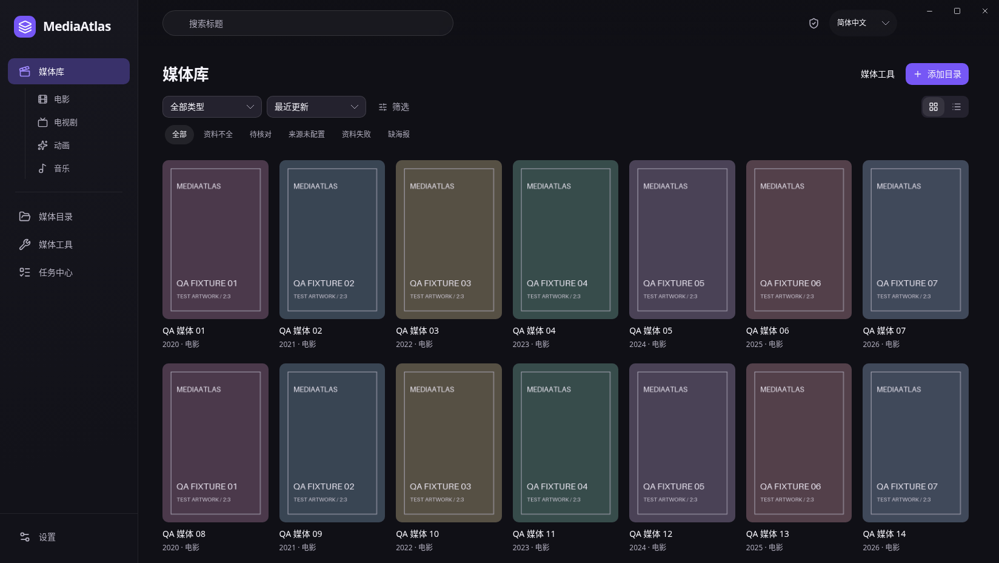

# MediaAtlas

**把本地影音收藏整理成可浏览、可检索的媒体库。**

MediaAtlas 是一款开源桌面媒体管理工具，用于管理电影、电视剧、动画和音乐。添加媒体目录后，应用会在后台发现文件、读取已有资料，并从配置的来源补全元数据；你可以浏览海报墙、核对匹配结果、维护 NFO，再通过系统关联的播放器打开媒体。

[下载安装](https://github.com/susanforme/MediaAtlas/releases) · [快速开始](#快速开始) · [使用文档](docs/README.md) · [问题反馈](https://github.com/susanforme/MediaAtlas/issues)

项目目前处于 **Beta** 阶段。本页介绍当前开发版本，已发布安装包的功能以对应 Release 说明为准。



界面预览摄于 2026-11-04，使用演示数据。更多界面及截图说明见 [截图目录](screenshots/README.md)。

## 主要功能

- **自动建立媒体库**：添加目录后后台扫描，本地文件先显示，资料尚未补全也能浏览和打开。
- **影视资料识别**：按片名和年份查找，或通过 TMDB / OMDb 识别 IMDb 链接与 ID，获取简介、海报、演职员、类型和评分；有歧义时保留待核对状态。
- **人工核对与合并**：逐项处理匹配结果，预览字段变化、选择补充资料，保留手动修改和锁定字段。
- **Kodi NFO**：优先读取已有的有效 NFO，为可靠识别的媒体自动生成缺失 NFO，支持 HTTPS 图片引用与离线图片导出。
- **音乐资料与标签**：管理音乐人、专辑版本和曲目，查询 MusicBrainz 与封面，预览并确认本地音频标签修改，支持恢复。
- **文件整理**：预览移动、复制或硬链接计划，确认后执行，并提供操作记录与回滚预览。
- **任务与维护**：在统一日志列表查看扫描和资料来源任务的状态、结果及失败原因，取消进行中的任务；支持数据库备份、恢复和诊断导出。
- **桌面体验**：支持 Windows、macOS 和 Linux，提供简体中文、英文及深浅色主题；媒体通过系统关联应用打开。

## 下载与安装

前往 [GitHub Releases](https://github.com/susanforme/MediaAtlas/releases)，根据操作系统和处理器选择安装包。具体可下载文件以该版本的资产列表为准。

| 系统 | 架构 | 包格式 |
| --- | --- | --- |
| Windows | x64 | 安装版 `.exe` / 便携版 `.zip` |
| macOS（Apple Silicon，M 系列） | ARM64 / `aarch64` | `.dmg` |
| macOS（Intel） | x64 / `x86_64` | `.dmg` |
| Linux（Debian / Ubuntu 系） | x64 | `.deb` |

- Windows 依赖 WebView2 Runtime；便携版需要系统已安装该运行时。
- macOS Beta 暂无 Developer ID 签名与 Apple 公证，首次打开问题见 [macOS 安装说明](docs/hotfix-macos-package.md)。
- Linux 使用系统 WebKitGTK / GTK 依赖，当前不提供 AppImage。

更新时先在应用中备份数据库，完全退出后安装新版本或替换便携应用。目前通过 Releases 手动更新，详见 [备份、恢复与更新](docs/maintenance.md)。

## 快速开始

1. **添加媒体目录**：打开应用，点击“添加目录”，通过系统文件夹选择器选中目录，确认名称和内容类型。
2. **浏览本地媒体**：目录保存后自动在后台扫描。已发现的本地媒体会陆续显示，已有的有效 NFO 会优先读取。
3. **配置在线资料来源（可选）**：在设置中手动保存所需凭据、启用来源，再为目录选择来源及优先顺序。已有目录通过“更新媒体库”继续获取资料。
4. **处理需要核对的条目**：根据“来源未配置”“待核对”“资料获取失败”等状态进入处理。手动选定匹配结果后，核对字段变化再确认。
5. **打开媒体**：进入媒体详情，通过系统关联应用打开文件；存在多个版本或分段时，先选择要打开的文件。

来源或网络暂不可用时，本地媒体仍可浏览。扫描与资料获取的进展可以在任务中心查看。

## 数据来源

| 用途 | 已接入来源 |
| --- | --- |
| 电影与电视剧 | TMDB、OMDb、豆瓣、TVmaze |
| 动画 | AniList、Bangumi |
| 百科补充资料 | Wikipedia |
| 音乐资料与封面 | MusicBrainz、Cover Art Archive |
| 成人资源资料（需在设置中启用资源类型） | FANZA / DMM、Wikidata |

不同来源的媒体覆盖、字段和语言有所不同。可以为目录选择多个来源并调整优先级；未选择来源时，仅使用本地资料。

TMDB、OMDb、FANZA / DMM 等来源需要相应凭据或账号权限。凭据由用户在设置中手动保存，默认存入系统密钥服务，也可选择仅本次会话有效。**保存凭据、启用来源和更新媒体库是独立操作。**

在线资料获取受网络、账号权限和站点限制影响，豆瓣等公开页面来源可能出现验证或访问受限。各来源的配置、使用条件和资料归属见 [来源与访问说明](docs/provider-access.md)。

## 媒体文件与资料保存

MediaAtlas 将媒体库索引存储在本机，按以下规则处理媒体目录中的文件：

| 操作 | 对文件的影响 |
| --- | --- |
| 浏览、扫描与资料识别 | 读取源媒体文件，保存应用索引与图片缓存，不改写源视频内容。 |
| 自动生成 NFO | 为可靠识别的媒体补充缺失 NFO；已有 NFO 默认保留，不重复自动刮削。 |
| 离线图片模式 | 普通视频目录明确选择并保存此模式后，后台生成缺失 NFO 时会同时导出配套图片；默认模式仅写入 HTTPS 图片引用。 |
| 再次刮削与 NFO 更新 | 手动核对资料并确认导出后，更新同名 NFO，保留原文件备份。 |
| 音频标签与文件整理 | 先预览，明确确认后才写入标签或执行文件操作；恢复与回滚也需单独核对。 |

应用运行时，普通视频目录默认监听文件变化，可在目录设置中关闭。删除已识别媒体的 NFO 后，应用会使用保存的可靠资料尝试补回；离线图片是否能补齐取决于现有图片或可用来源。

NFO 与图片的导出规则见 [媒体资料输出](docs/media-output.md)，音乐标签见 [音乐功能说明](docs/phase-6-contract.md)。

## 成人资源

成人资源类型默认关闭，可在设置中启用。启用后使用同一套媒体浏览、详情和资料工具，内容通过对应资源类型访问，保持与普通“全部”列表和普通搜索分离；关闭后取消相关查询并清理缓存。

## 从源码开发

桌面端基于 **Tauri 2、React、TypeScript 和 Rust**，使用 SQLite 保存本地媒体库，复用系统 WebView。

开发前准备：

- Node.js 22.12 或以上，推荐 24 LTS。
- pnpm **12.17.0**，与根 `package.json` 保持一致。
- Rust **1.90.0**，由 `rust-toolchain.toml` 固定。
- 对应操作系统的 [Tauri 2 前置依赖](https://v2.tauri.app/start/prerequisites/)。

```bash
git clone https://github.com/susanforme/MediaAtlas.git
cd MediaAtlas
pnpm install --frozen-lockfile
pnpm dev
```

常用命令，在仓库根目录执行：

```bash
pnpm dev:web         # 仅预览前端，不具备桌面后端能力
pnpm check           # 前端 lint、类型检查、测试与构建
cargo test --locked  # Rust 核心模块与扫描器测试
pnpm build:desktop   # 构建本平台桌面可执行文件，不生成安装包
```

项目结构与接口见 [架构文档](docs/architecture.md)和 [文档索引](docs/README.md)；安装包构建与发布见 [发布说明](scripts/release/README.md)。

## 反馈与贡献

欢迎通过 [Issues](https://github.com/susanforme/MediaAtlas/issues) 报告问题或提出建议，通过 Pull Request 贡献代码、文档和翻译。

报告问题时，请附上操作系统、应用版本、复现步骤和脱敏后的错误信息。界面、业务边界和开发约定见 [设计规范](design.md)与 [AGENTS.md](AGENTS.md)。

## 许可证

MediaAtlas 源码采用 [MIT License](LICENSE.md)。第三方依赖及分发材料的许可说明见 [THIRD_PARTY_NOTICES.md](THIRD_PARTY_NOTICES.md)。在线元数据与图片的权利归各来源及权利人所有，使用时需遵守对应条款。
