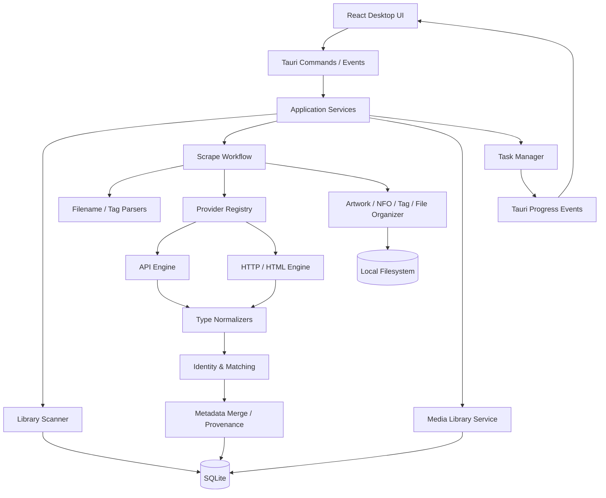
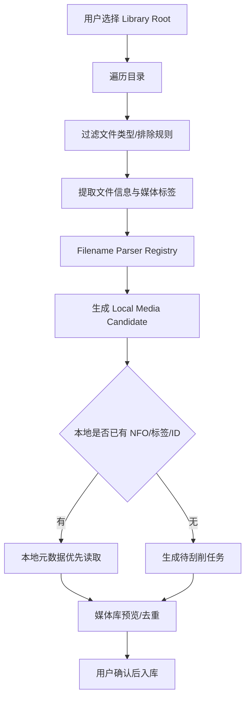

# Universal Media Scraper — Agent 执行计划

> 文档类型：Architecture & Implementation Plan  
> 目标：交给 Codex / OpenCode / Claude Code 等 Coding Agent，按阶段实现一个 Windows 优先、兼容 macOS/Linux 的本地多媒体刮削与媒体库管理桌面应用。  
> 项目代号：`Universal Media Scraper`（名称可后续调整）  
> 文档状态：实施基线；任何偏离必须先说明原因、影响和替代方案。

---

## 0. Agent 开工指令

你是本项目的主程 Agent。请严格按本文件实施，不要一次性生成所有功能，不要先堆 UI 假数据，也不要为了“未来扩展”引入尚无实际用途的抽象。

### 必须遵守

1. **先审计仓库，再修改代码。** 检查当前目录、已有代码、依赖、构建方式、Git 状态；不得覆盖用户已有实现。
2. 先创建并维护 `docs/` 中的架构决策、数据模型、Provider 契约和阶段计划，再开始对应实现。
3. 每个阶段必须有可运行产物、自动化测试和验收记录。阶段未验收，不进入下一阶段。
4. 不允许把所有业务塞进一个巨大 `MediaMetadata`、一个万能 Parser 或一个巨大 Provider Trait。
5. 不允许 UI 直接发 HTTP 请求访问刮削站点。所有网络采集由 Rust 后端统一执行。
6. 不允许使用 Playwright、Puppeteer、Selenium 或内置 Chromium 作为刮削基础设施。第一版只使用 API + HTTP/HTML 双引擎。
7. 不允许把 JAV 的字段、番号和抓取规则混入普通电影模型；普通影视、JAV、音乐必须拥有独立领域模型和匹配策略。
8. 文件写入、移动、重命名、标签修改必须先生成 Preview/Diff，用户确认后才能执行。默认不破坏源文件。
9. 用户手工编辑的数据优先级最高；后续刮削不得静默覆盖用户锁定字段。
10. 不得复制 MDCz 的代码或 UI 资产。仅参考其公开行为、模块边界和交互模式；如确需复用代码，必须先检查其 GPL-3.0 许可并由项目所有者明确决定是否接受 GPL 义务。
11. 外部站点访问必须遵守目标站点条款、版权和当地法律；不得绕过验证码、登录限制、付费墙或访问控制。Provider 应能优雅处理 403、429、验证码页和站点不可用。
12. 不得伪造 Provider 成功率、刮削结果或媒体库数据。开发数据必须明确标记为 Fixture/Demo。

### 每阶段结束时输出

- 已完成内容和对应文件路径。
- 执行过的测试命令及结果。
- 未完成项、已知问题和风险。
- 与本计划不一致的设计决策及理由。
- 下一阶段的具体任务清单。

---

## 1. 产品目标与范围

### 1.1 产品定位

构建一个本地优先（Local-first）的多媒体元数据刮削和媒体库管理工具：

- Windows 为第一目标平台，同时兼容 macOS / Linux。
- 支持 API 与 HTTP/HTML 两种刮削引擎。
- 能从文件夹扫描媒体、解析文件名/标签、匹配元数据、下载图片、整理文件并生成 NFO/标签。
- 用户能在应用内看到完整媒体库，包括海报墙、列表、筛选、详情、缺失元数据和任务状态；体验参考 MDCz 的媒体库浏览方式。
- JAV 业务流程和 UI 交互主要参考 MDCz；普通电影、电视剧、动画参考 Jellyfin / MediaElch 的 Provider、搜索、详情、图片和本地 NFO 分层设计。
- 音乐采用 MusicBrainz 的 Artist / Release Group / Release / Recording / Track 实体模型，不套用影视模型。

### 1.2 首批媒体类型

| 域 | 类型 | MVP | 说明 |
|---|---|---:|---|
| 普通视频 | Movie | 是 | 电影、短片可先归入 Movie 并通过 subtype 区分 |
| 普通视频 | TV Series / Season / Episode | 是 | 支持季集层级、季集命名和 NFO |
| 动画 | Anime | 是（基础） | 可映射到 TV/Movie，同时保留 AniDB/AniList/Bangumi 标识和番剧扩展字段 |
| 成人视频 | JAV | 是 | 独立番号、片商、发行商、演员、系列和图片模型；独立媒体库视图 |
| 音频 | Music | 第二阶段 | Artist、Release Group、Release、Medium、Track、Recording |
| 视频扩展 | MV / Concert | 后续 | 复用 Music + Video 关联，不另造一套完整媒体核心 |
| 其他 | Game / Book / Podcast / Audiobook | 后续 | 只预留 MediaKind 扩展点，不在 MVP 实现空壳模块 |

### 1.3 非目标

- 不做媒体播放器，不负责视频/音频解码。
- 不做下载器，不下载受版权保护的完整视频或音频内容。
- 不做云端账号系统；第一版单机本地数据库。
- 不做浏览器自动化爬虫。
- 不以兼容所有媒体服务器的私有 NFO 扩展为第一目标；先保证自有数据模型和通用 NFO 导出。

---

## 2. 参考项目与借鉴边界

### 2.1 MDCz：JAV 与媒体库交互的主要参考

仓库：<https://github.com/ShotHeadman/mdcz>

已检查其公开仓库结构与部分源码。值得参考的模块：

| MDCz 模块/文件 | 借鉴点 | 本项目落地位置 |
|---|---|---|
| `packages/runtime/src/crawler/CrawlerProvider.ts` | 站点注册、适配器缓存、站点健康状态、失败分类和冷却 | `scraper/provider_registry`、`scraper/provider_runtime` |
| `packages/runtime/src/crawler/base/BaseCrawler.ts` | 搜索页→详情页的统一 HTTP 抓取流程、解析失败分类、编号核验 | `scraper/html_engine`、各 JAV Provider |
| `packages/runtime/src/crawler/base/types.ts` | 输入/输出、错误结果、站点适配器契约 | Rust Provider 契约 |
| `packages/runtime/src/crawler/sites/*` | DMM、JavDB、JavBus、MGStage、R18 等站点适配器的独立组织方式 | `providers/adult/*` |
| `packages/runtime/src/scrape/FileScraper.ts` | 刮削编排、下载图片、NFO、任务进度和发布前准备 | `application/scrape_workflow` |
| `packages/runtime/src/scrape/FileOrganizer.ts` | 命名模板、目录规划、文件关联、移动/硬链接/复制策略 | `file_organizer` |
| `packages/runtime/src/library/mediaLibraryService.ts` | 媒体库业务服务边界 | `library_service` |
| `packages/persistence/src/libraryRepository.ts` | 媒体条目、文件、图片资产分离；分页、过滤、统计和 Facets | SQLite Repository |
| `packages/views/src/library/LibraryPosterWall.tsx` | 海报墙浏览 | React `MediaLibrary/PosterWall` |
| `packages/views/src/library/LibraryBrowsePanel.tsx` | 媒体库筛选、Facet、健康问题筛选 | React `MediaLibrary/Toolbar` |
| `packages/runtime/src/scrape/nfo.ts` 及相关 NFO 模块 | NFO 读写、人工修改保护、媒体库维护 | `exporter/nfo`、`metadata_provenance` |

**不要照搬 MDCz 当前技术栈。** MDCz 当前是 Electron + React + TypeScript + Node 服务端/SQLite；本项目采用 Tauri 2 + React + Rust。借鉴的是业务流程和 UI 组织，不是把 Node 代码机械翻译成 Rust。

MDCz README 当前列出的产品能力还包括多站点聚合、演员别名归一、Emby/Jellyfin 集成、分段视频、STRM、字幕关联、批量任务和 Diff Preview。优先借鉴其中与本项目范围相符的部分，不在 MVP 同时实现所有集成。

### 2.2 普通电影/电视剧：Jellyfin 与 MediaElch

- Jellyfin：<https://github.com/jellyfin/jellyfin>
- MediaElch：<https://github.com/Komet/MediaElch>

重点参考：

1. Jellyfin 的 `IMetadataProvider` / `IRemoteMetadataProvider` / `IRemoteSearchProvider` 分层：搜索和详情获取是明确的不同能力；图片 Provider、Local Metadata Provider 也应与远程元数据 Provider 分开。
2. Jellyfin `MovieMetadataService`：媒体类型自己的 Metadata Service 负责类型专属字段合并，而不是让一个全局对象处理所有类型。
3. Jellyfin `IHasProviderIds`：外部 ID 应以 Provider 命名空间保存，不应只留一个通用 ID。
4. MediaElch `docs/adr/scraper-interface.md`：Provider 应公开 identifier、name、description、website、ToS、privacy、supported details、languages 等能力信息；搜索/详情应产生独立、不可变的 Job 输入，避免用户切换媒体或设置后结果写错对象。
5. 电视剧支持 Show、Season、Episode 的独立搜索/加载流程，并考虑 aired order、DVD order、absolute/anime order。

### 2.3 参考源码链接

- MDCz crawler base：<https://github.com/ShotHeadman/mdcz/tree/main/packages/runtime/src/crawler>
- MDCz scrape：<https://github.com/ShotHeadman/mdcz/tree/main/packages/runtime/src/scrape>
- MDCz library UI：<https://github.com/ShotHeadman/mdcz/tree/main/packages/views/src/library>
- MDCz library persistence：<https://github.com/ShotHeadman/mdcz/tree/main/packages/persistence/src>
- Jellyfin Provider contracts：<https://github.com/jellyfin/jellyfin/tree/master/MediaBrowser.Controller/Providers>
- Jellyfin Movie metadata service：<https://github.com/jellyfin/jellyfin/blob/master/MediaBrowser.Providers/Movies/MovieMetadataService.cs>
- MediaElch scraper ADR：<https://github.com/Komet/MediaElch/blob/master/docs/adr/scraper-interface.md>

---

## 3. 技术选型

| 层 | 选型 | 约束 |
|---|---|---|
| Desktop shell | Tauri 2 | 只做窗口、系统托盘、文件选择、权限和更新集成 |
| Frontend | React + TypeScript + Vite | UI 不直接访问外部刮削站点 |
| UI | Tailwind CSS + shadcn/ui + lucide-react | 统一组件与设计 Token |
| Routing | TanStack Router | 页面路由和搜索参数可恢复 |
| State | Zustand（少量全局状态）+ TanStack Query（服务端状态） | 不重复缓存后端数据 |
| IPC | Tauri Commands + Events | 命令负责请求/响应，事件负责任务进度和状态推送 |
| Core | Rust stable | 业务逻辑与 Tauri 解耦 |
| Async | Tokio | 网络、任务队列和文件异步操作 |
| HTTP | reqwest | 统一 Client、连接池、超时、代理、Cookie、重试和限流 |
| HTML | scraper（CSS Selector） | 首版不实现浏览器渲染；XPath 可按需求增加 |
| JSON | serde / serde_json | API 与内嵌 JSON |
| XML/NFO | quick-xml 或 roxmltree + quick-xml | 读写 XML，保留未知字段策略需测试 |
| Database | SQLite + SQLx | WAL、迁移、外键、索引；Repository 封装 SQL |
| Image | image crate | 图片校验、尺寸读取、缩略图；避免无必要重编码 |
| Audio tags | lofty | 读取/写入 ID3、FLAC、MP4 等标签，写入前备份 |
| Media probe | ffprobe 可选外部工具，或 mediainfo 绑定 | 不将视频解码器嵌入核心；明确分发许可和可选安装 |
| Logging | tracing + tracing-subscriber | 结构化日志、脱敏、滚动文件 |
| Tests | cargo test + Vitest + Playwright 仅用于 UI E2E（不用于刮削） | UI 测试可用浏览器自动化，但刮削运行时不依赖浏览器 |
| Build | pnpm + Cargo | Windows 优先 CI，同时构建 macOS/Linux |

### 3.1 双引擎定义

**API Engine**：REST、GraphQL、JSON endpoint、分页、鉴权、响应解析。  
**Web Engine**：普通 HTTP 获取 HTML，使用 CSS Selector、JSON-LD、Open Graph、内嵌 JSON 提取数据。

Provider 可组合两种 Engine。例如先调用 JSON API，API 不提供某字段时再解析公开详情 HTML。Provider 不等于 Engine。

**明确禁止：** Playwright/Puppeteer/Selenium/Chromium 不作为刮削方案，不启动浏览器进程处理批量媒体。遇到 JS 网站时，先评估是否存在公开 JSON endpoint；无法用 HTTP 可靠获取时，将该 Provider 标记为不支持/部分支持，不用浏览器自动化强行兜底。

### 3.2 网络基础设施

- 每个 Provider 独立配置 timeout、并发上限、速率限制、代理、Cookie/Token、User-Agent、Referer。
- 统一识别 `timeout`、`dns_error`、`tls_error`、`network_error`、`http_4xx`、`http_5xx`、`rate_limited`、`blocked`、`captcha`、`not_found`、`parse_error`、`identity_mismatch`。
- 对 429 读取 `Retry-After`；按站点冷却，不要全局停摆。
- 连续网络失败触发 Provider 暂停/健康状态，恢复后允许探测。
- 使用 `CancellationToken` 取消请求；每次 Job 固化 Provider 配置快照，配置变化不得污染正在执行的 Job。
- 默认不记录 Cookie、API Key、Authorization、敏感 URL query。
- 实现 SSRF 防护：阻止 localhost、私网、link-local、云 metadata 地址；限制重定向目标；限制响应大小和下载类型。

---

## 4. 总体架构



### 4.1 架构边界

- `domain` 不依赖 Tauri、SQLite、HTTP、React。
- `application` 编排扫描、搜索、匹配、合并、预览和提交。
- `infrastructure` 实现 Provider、HTTP、HTML、SQLite、文件系统和图片下载。
- `desktop` 只负责 IPC 适配和桌面能力。
- `frontend` 只消费稳定 DTO，不依赖 Rust 内部结构。
- 媒体库是本地资产索引，不等同于外部 Provider 返回的搜索结果。

### 4.2 推荐 Rust Workspace

初期避免拆成几十个 crate。先用一个 workspace、少量 crate，内部按模块组织；只有依赖边界稳定且确实需要独立编译/复用时再拆 crate。

```text
universal-media-scraper/
├── apps/
│   └── desktop/
│       ├── src/                         # React UI
│       │   ├── app/
│       │   ├── routes/
│       │   ├── components/
│       │   ├── features/
│       │   │   ├── dashboard/
│       │   │   ├── library/
│       │   │   ├── scraper/
│       │   │   ├── file-scanner/
│       │   │   ├── metadata-editor/
│       │   │   ├── providers/
│       │   │   ├── tasks/
│       │   │   ├── settings/
│       │   │   ├── movie/
│       │   │   ├── tv/
│       │   │   ├── anime/
│       │   │   ├── adult-video/
│       │   │   └── music/
│       │   ├── api/                     # typed IPC client
│       │   ├── stores/
│       │   ├── i18n/
│       │   └── main.tsx
│       └── src-tauri/
│           ├── src/
│           │   ├── commands/
│           │   ├── events/
│           │   ├── state.rs
│           │   └── lib.rs
│           ├── capabilities/
│           └── tauri.conf.json
├── crates/
│   ├── domain/                          # 领域模型、值对象、错误
│   ├── application/                     # Use cases / workflows / DTO
│   ├── infrastructure/                  # SQLite、HTTP、文件系统
│   ├── scraper/                         # Provider、API/HTML engine、matching
│   ├── media-scanner/                   # 目录扫描、媒体探测、文件名解析
│   ├── media-export/                    # NFO、JSON、图片、音频标签
│   └── desktop-bridge/                  # Tauri command/event adapters
├── providers/
│   ├── movie-tmdb/
│   ├── movie-omdb/                      # 仅在 API 使用条件确认后启用
│   ├── tv-tvdb/
│   ├── anime-anilist/
│   ├── anime-anidb/
│   ├── anime-bangumi/
│   ├── adult-dmm/
│   ├── adult-javdb/
│   ├── adult-javbus/
│   ├── adult-mgstage/
│   ├── music-musicbrainz/
│   └── music-discogs/
├── config/
│   ├── provider-schemas/
│   └── filename-rules/
├── docs/
│   ├── architecture.md
│   ├── adr/
│   ├── domain-model.md
│   ├── provider-contract.md
│   ├── database-schema.md
│   ├── library-workflow.md
│   ├── ui-spec.md
│   └── agent-plan.md
├── fixtures/
│   ├── html/
│   ├── json/
│   ├── nfo/
│   └── filenames/
├── tests/
│   ├── integration/
│   └── e2e/
├── Cargo.toml
├── pnpm-workspace.yaml
├── package.json
├── rust-toolchain.toml
└── README.md
```

Provider 目录可以在稳定后迁入 workspace crate。每个 Provider 必须独立测试，且不能依赖 UI。

---

## 5. 领域模型设计

### 5.1 统一实体，不统一所有字段

核心原则：**统一媒体库条目、文件、图片、人员、外部 ID 和来源追踪；各媒体类型拥有独立扩展模型。**

公共实体：

- `MediaItem`：本地媒体库的逻辑作品。
- `MediaFile`：磁盘上的一个或多个文件，允许同一作品多版本/多 Part。
- `Artwork`：海报、背景图、Logo、Thumb、Scene、Artist、Album Cover 等资产。
- `Person`：演员、导演、艺术家、作曲者等人员实体。
- `Organization`：片商、发行商、制作公司、唱片公司等组织实体。
- `ExternalId`：provider + namespace + value。
- `Credit`：媒体与人员/组织之间的角色关系。
- `MetadataValue`：字段值、来源 Provider、来源 URL、抓取时间、置信度、用户锁定状态。

### 5.2 MediaKind

```rust
enum MediaKind {
    Movie,
    TvSeries,
    TvSeason,
    TvEpisode,
    Anime,
    AdultVideo,
    MusicArtist,
    MusicReleaseGroup,
    MusicRelease,
    MusicTrack,
    MusicRecording,
    MusicVideo,
    Concert,
}
```

Anime 可以关联 TV/Movie 的基础实体，同时保存 Anime 专属扩展（format、season、cour、studio、source、AniDB/AniList/Bangumi IDs）。不要把 Anime 强制变成独立且无法与 TV 关联的孤岛。

### 5.3 普通影视模型

`MovieMetadata`：runtime、budget、revenue、original_language、production_companies、collection。  
`TvSeriesMetadata`：status、network、first_air_date、last_air_date、season_order。  
`SeasonMetadata`：series_id、season_number、name、overview、poster。  
`EpisodeMetadata`：series_id、season_id、season_number、episode_number、absolute_number、air_date、runtime、still。

电视剧必须明确 episode order：`Aired`、`DVD`、`Absolute`、`Anime`。同一集的不同编号方案通过映射保存，不要假设 `SxxExx` 永远唯一。

### 5.4 JAV 模型

JAV 必须作为独立 `AdultVideo` 领域：

- `catalog_numbers[]`：原始番号、标准化番号、发行商/命名空间、主番号标记、别名。
- `studio`、`label`、`series`。
- `release_date`、`runtime`、`title`、`original_title`、`description`。
- `performers[]`、`directors[]`、`genres[]`。
- `cover`、`back_cover`、`samples[]`、`trailer`（按 Provider 能力）。
- `source_provider`、`source_url`、字段级来源。

番号标准化必须可测试，保留原始值，不能仅通过删除所有标点来合并。相同番号不同发行商、重发版、无码/有码/合集等冲突需要进入候选匹配或人工确认。

### 5.5 音乐模型

音乐必须区分：

`Artist → ReleaseGroup → Release → Medium → Track → Recording`

并支持：

- Artist ID、Release Group ID、Release ID、Recording ID、Track ID。
- ISRC、UPC/EAN、Catalog Number。
- 多碟专辑、不同地区版本、豪华版、重制版。
- Artist / Album / Track 之间的 Credit 和 Alias。
- 本地标签与在线数据差异比较。

读取/写入 MP3(ID3)、FLAC、M4A/MP4、OGG、OPUS、WAV（按 lofty 实际支持范围声明）。写入标签前必须创建备份或可回滚副本。

### 5.6 外部 ID 与来源追踪

外部 ID 不能用 `tmdb_id`、`imdb_id` 等散落字段堆积。使用：

```text
external_ids
- id
- media_item_id
- provider_id
- namespace
- external_id
- is_primary
- created_at

metadata_values
- id
- media_item_id
- field_key
- value_json
- provider_id
- source_url
- fetched_at
- confidence
- is_user_modified
- is_locked
```

字段锁定规则：`locked/user_modified > user-selected provider preference > provider priority > fallback`。合并时输出 Diff，不静默覆盖。

---

## 6. Provider 契约与采集策略

### 6.1 Provider 元数据

每个 Provider 声明：

- `id`（稳定、唯一、小写）
- `name`、`description`、`website`
- `terms_url`、`privacy_url`、`documentation_url`
- `supported_media_kinds`
- `supported_operations`：search / detail / images / people / seasons / episodes / releases / tracks
- `supported_languages`
- `engine_types`：api / html
- `requires_api_key`、`requires_login`（默认 false）
- `rate_limit_policy`
- `attribution`、`license_notes`、`data_usage_notes`

### 6.2 分能力接口

不要设计一个要求所有 Provider 实现所有方法的万能 Trait。按能力拆分：

```rust
trait ProviderInfo { fn descriptor(&self) -> ProviderDescriptor; }
trait SearchProvider<TQuery, TResult> { async fn search(&self, query: TQuery, ctx: &ProviderContext) -> Result<Vec<TResult>>; }
trait MetadataProvider<TId, TMetadata> { async fn fetch_metadata(&self, id: TId, ctx: &ProviderContext) -> Result<TMetadata>; }
trait ArtworkProvider<TId> { async fn fetch_artwork(&self, id: TId, ctx: &ProviderContext) -> Result<Vec<ArtworkCandidate>>; }
```

实际实现时使用 Rust async trait 兼容当前稳定工具链；如需要对象安全，使用 boxed future 或具体的 enum dispatch。不要为了抽象而制造空实现。

### 6.3 Search Job 必须不可变

一次搜索/详情任务必须携带不可变输入快照：

- query / media kind / file identity。
- provider ID 和 provider config snapshot。
- language / region。
- cancellation token。
- task ID / correlation ID。

不能让 Provider 从 UI 全局状态中读取“当前选中的媒体”。避免用户切换页面后，旧任务把结果写入新作品。

### 6.4 普通影视 Provider

MVP 首选：

1. TMDB：电影、电视剧、季、集、图片和外部 ID。
2. TVDB：作为可配置补充 Provider；在 API Key、条款和访问策略确认后启用。
3. IMDb：仅使用明确许可的公开数据/接口或允许的外部 ID 关联方式，不以无边界网页抓取作为基础依赖。
4. Anime：AniList、AniDB、Bangumi 分别作为可选 Provider；Provider 返回的作品 ID、季集编号和语言信息必须保留。

### 6.5 JAV Provider

先实现 MDCz 风格的站点适配器架构，再逐个接入：DMM、MGStage、JavDB、JavBus、R18、AVBase、AVWikiDB 等作为候选列表。具体接入前检查网站可访问性、接口稳定性、条款和区域限制；不承诺所有站点长期可用。

每个 JAV Provider 需要：

- `parse_catalog_number` 或接受标准化 CatalogNumber。
- `search_by_number`（如果站点支持）。
- `search_by_title`（可选）。
- `fetch_detail`。
- `fetch_artwork`（可选）。
- 返回站点原始 ID、详情 URL、番号候选、别名和字段来源。
- 在详情数据返回后再次校验番号，防止错误详情页被当作命中。

### 6.6 音乐 Provider

- MusicBrainz：核心音乐实体和 ID。
- Cover Art Archive：封面资源。
- Discogs：发行版本和实体补充；使用 API 时遵守授权、速率限制和用户配置。

---

## 7. 媒体库与文件扫描

### 7.1 媒体库是核心功能，不是刮削完成后的附属页面

必须支持用户看到已经收录的所有媒体。媒体库数据与 Provider 搜索结果分离：Provider 结果先进入候选/预览，用户确认并保存后才成为正式 `MediaItem`。

### 7.2 Library Root

用户可添加多个根目录，并设置媒体类型：

- Movies
- TV Shows
- Anime
- Adult Video
- Music
- Mixed（仅允许显式选择，不作为默认）

每个 Root 保存：ID、显示名称、绝对路径、媒体类型、是否启用、扫描策略、输出策略、最后扫描时间。

路径存储必须使用 `root_id + relative_path`，避免把绝对路径作为唯一身份。Windows 路径大小写/盘符、UNC、macOS/Linux 大小写敏感差异必须通过平台适配层处理。

### 7.3 Scanner 流程



扫描默认不触发大量外网请求。先建立本地文件索引和识别结果，再由用户启动批量刮削。

### 7.4 文件分组

- Movie：同一作品多个 Part、不同分辨率/版本、外挂字幕、NFO 和图片归为一个 MediaItem。
- TV：Series / Season / Episode 分层；文件名解析支持 `S01E01`、`1x01`、绝对集数和用户自定义规则。
- Anime：支持绝对集数、季/季度、字幕组文件名；识别不确定时进入人工确认。
- JAV：按 Catalog Number + 目录上下文聚合；CD1/CD2/Part、字幕和预览图片作为关联文件。
- Music：按 Artist/Album/Disc/Track 标签和目录结构归组；不以文件名作为唯一依据。

### 7.5 文件组织策略

提供 `Preserve`（原地保留）、`Move`、`Copy`、`Hardlink`（仅同卷且平台支持）等策略。默认 `Preserve`。

任何操作先产生 `OrganizationPlan`：源路径、目标路径、冲突、将生成的 NFO/图片、字幕/附件关联、预计文件数和空间。用户确认后执行，并写入操作日志；失败时可回滚已完成步骤。

### 7.6 监控

MVP 支持手动扫描和增量扫描。文件系统 Watcher 放在后续阶段；Watcher 事件必须去抖、合并并通过同一 Scanner Pipeline，避免重复任务。

---

## 8. 刮削、匹配和合并工作流

### 8.1 通用流程

1. 用户从媒体库选择一个候选，或手动输入搜索词。
2. 根据媒体类型选择 Parser 和 Provider 集合。
3. 并发搜索多个 Provider（遵守各自限流）。
4. 将 Provider 响应标准化为候选 DTO，但保留原始 Provider ID 和 URL。
5. 跨 Provider 去重：优先使用相同外部 ID；无 ID 时用类型专属规则。
6. 展示候选和来源，允许用户选择主结果。
7. 拉取完整详情和图片候选。
8. 生成字段级 Merge Preview，显示新值、旧值、来源、是否覆盖用户值。
9. 用户确认后写入数据库和所选文件输出。
10. 记录 ScrapeRun、字段来源和文件操作记录。

### 8.2 匹配策略按媒体类型分开

**Movie/TV**：Provider ID > IMDb/TMDB/TVDB IDs > 标题+年份+类型 > 人工选择。  
**Anime**：AniDB/AniList/Bangumi IDs > 标题别名/季/绝对集数/年份 > 人工选择。  
**JAV**：精确 Catalog Number + 发行商命名空间 > 规范化番号/别名 > 标题/演员/发行日期辅助；详情页必须复核番号。  
**Music**：MusicBrainz IDs / ISRC / UPC/EAN > Artist + Album + Date + Tracklist > 模糊匹配。

禁止使用一个通用标题相似度权重模型处理所有媒体类型。

### 8.3 合并策略

- 字段级来源与用户锁定。
- Provider 优先级按 MediaKind 分开配置。
- 图片选择与文字字段选择分开。
- 多语言字段按 locale 保存，不覆盖其他语言。
- 人员 Alias 通过独立实体关联，禁止仅凭相同字符串自动合并真人实体。
- 对不确定冲突生成 `NeedsReview`，不自动覆盖。

---

## 9. 媒体库 UI 规划

整体交互参考 MDCz 的媒体库浏览体验：**有真实可浏览的媒体库，而不是只有刮削搜索框。** 页面采用左侧导航 + 主内容区，桌面优先。

### 9.1 主导航

```text
Workspace
  Dashboard
  Media Library
  Scraper
  File Scanner
  Task Center

Media Types
  Movies
  TV Shows
  Anime
  Adult Video       # 独立分区，可隐藏/锁定
  Music

System
  Providers
  Settings
  Logs
```

### 9.2 Media Library 页面

必须提供：

- Poster Wall（海报墙）与 List View（列表视图）切换。
- 媒体类型筛选、Library Root 筛选、搜索框。
- 分页/虚拟列表，不能一次性加载所有媒体和原图。
- 海报缺失、背景图缺失、NFO 缺失、元数据不完整、重复媒体等健康筛选。
- Genre、Actor/Performer、Director、Studio/Label、Year 等 Facets；Facet 按媒体类型决定显示字段。
- 排序：标题、年份、添加时间、更新时间、评分（仅有评分时）。
- 批量选择、批量重新刮削、批量导出、批量整理；批量破坏性操作必须 Diff Preview。
- 空状态、加载状态、错误状态、无结果状态。

### 9.3 Poster Wall

海报卡片至少显示：海报、标题、年份、媒体类型、缺失/异常状态。悬停时显示轻量操作；点击进入详情。图片使用本地缩略图缓存，优先加载缩略图而非远程原图。

### 9.4 Media Detail 页面

公共布局：主海报/背景、标题、年份、简介、评分、类型、外部 ID、图片画廊、文件列表、元数据来源。

类型专属 Tab：

- Movie：导演、演员、片长、制作公司、合集。
- TV：季、集、集列表和集图片。
- Anime：番剧格式、季度、制作社、别名、绝对集数。
- JAV：番号、片商、发行商、演员、系列、封面/样品图；不在普通电影详情里显示成人字段。
- Music：Artist、Release、Disc、Tracklist、标签信息和封面。

### 9.5 Scraper Workspace

支持按名称、外部 ID、JAV 番号、音乐 ID 搜索。左侧/上方选择媒体类型和 Provider；结果区展示多个 Provider 的候选卡片、来源和匹配理由。选中结果后进入详情字段对比和图片选择。

### 9.6 JAV UI 参考边界

参考 MDCz 的：番号优先搜索、站点选择/站点健康、聚合结果、演员别名映射、图片选择、批量工作台、执行前 Diff Preview、NFO 和文件整理流程。

JAV 页面必须是独立功能区，支持成人内容显示开关、锁定/隐藏入口、独立 Library Root、独立缩略图缓存和独立搜索结果。不得在 Dashboard 的普通媒体统计或普通电影海报墙中默认展示成人封面。

### 9.7 国际化

UI 首版提供简体中文和英文。内部枚举使用稳定英文 ID；显示文案通过 i18n，不把中文硬编码进 Rust 领域模型。媒体原始标题和本地化标题分字段保存。

---

## 10. 数据库初步 Schema

采用 SQLite + SQLx migrations。所有表使用稳定主键（UUID/ULID 均可，统一一种），时间统一 UTC。

### 10.1 通用表

- `library_roots`
- `media_items`
- `media_files`
- `media_relations`
- `external_ids`
- `metadata_values`
- `artworks`
- `persons`
- `person_aliases`
- `organizations`
- `credits`
- `genres`
- `media_genres`
- `provider_registry`
- `provider_settings`
- `scrape_tasks`
- `scrape_runs`
- `scrape_candidates`
- `file_operations`
- `http_cache`
- `app_settings`

### 10.2 类型扩展表

影视：`movie_metadata`、`tv_series_metadata`、`tv_seasons`、`tv_episodes`、`episode_number_mappings`。  
JAV：`adult_video_metadata`、`adult_catalog_numbers`、`adult_series`、`adult_studio_refs`、`adult_label_refs`。  
音乐：`music_artists`、`music_release_groups`、`music_releases`、`music_media`、`music_tracks`、`music_recordings`、`music_identifiers`。

### 10.3 媒体库查询

必须支持：

- `list_media(kind, root, query, facets, sort, cursor, limit)`。
- `get_media_detail(id)`。
- `get_library_summary(root/kind)`。
- `get_library_health(root/kind)`。
- `list_media_files(media_id)`。
- `list_artworks(media_id)`。

为 `media_items(kind, updated_at)`、`external_ids(provider_id, namespace, external_id)`、`media_files(root_id, relative_path)`、常用搜索字段建立索引。分页优先使用 cursor/keyset，不用大 offset 扫描。

### 10.4 数据库规则

- 开启 foreign_keys、WAL、busy_timeout。
- migrations 只能追加，禁止修改已经发布的迁移。
- Repository 封装查询；UI 和业务模块不能直接拼 SQL。
- 删除媒体条目时区分“从库中移除”和“删除磁盘文件”，默认只从库移除。
- 备份使用 SQLite backup API 或安全快照，不直接复制正在写入的 db 文件。

---

## 11. 任务管理与性能

### 11.1 任务类型

`ScanLibrary`、`ParseFile`、`SearchProviders`、`FetchMetadata`、`DownloadArtwork`、`MergeMetadata`、`ExportNfo`、`WriteAudioTags`、`OrganizeFiles`、`RefreshLibrary`。

任务状态：`Queued`、`Running`、`WaitingForUser`、`Succeeded`、`Failed`、`Cancelled`、`Interrupted`。

任务记录必须持久化；应用退出后将运行中任务标记为 Interrupted，并提供安全恢复策略。不要在启动时自动重放会移动/覆盖文件的任务。

### 11.2 并发与限流

初始建议值（必须可配置）：全局网络并发 12、单 Provider 并发 2、图片下载并发 4。每个 Provider 的速率限制优先于全局并发。避免为每个文件创建独立 HTTP Client；复用 Client 和连接池。

### 11.3 进度事件

通过 Tauri Events 推送：task-created、task-updated、task-log、task-needs-review、task-completed。事件载荷使用版本化 DTO，避免把内部 Rust struct 直接暴露给 UI。

### 11.4 性能验收

- 1000 条媒体库记录分页浏览，不一次性加载全部海报原图。
- 扫描 10,000 个文件时可取消、可显示进度，UI 不冻结。
- Provider 网络失败不阻塞其他 Provider。
- 同一图片 URL/内容不重复下载（缓存和哈希去重）。
- 同一文件重复触发扫描不产生重复媒体条目。

---

## 12. 安全、隐私与内容隔离

- 默认所有数据库、缓存、Cookie 和 API Key 存在本机应用数据目录。
- API Key 使用系统密钥存储（Windows Credential Manager、macOS Keychain、Linux Secret Service）；若不可用，提示用户并提供明确的加密/降级策略，不明文写日志。
- 成人媒体库默认关闭入口，可设置 PIN/系统验证作为可选保护；隐藏封面、缩略图和最近访问记录可配置。
- 成人内容数据不上传任何云端；未来如引入同步必须单独征求用户同意。
- Provider HTML 规则和图片 URL 必须经过目标 URL 校验，禁止访问本机和内网服务。
- 图片下载限制 MIME、最大尺寸、最大文件体积，防止恶意文件和解压炸弹。
- NFO/XML 解析禁用外部实体和外部 DTD。
- 日志默认脱敏 Cookie、Token、邮箱、用户目录中的敏感片段。

---

## 13. 开发阶段与 Agent 任务拆分

每个 Phase 是独立 PR/提交单元。不要并行修改同一领域模型；可以并行做 UI shell、数据库迁移和独立 Provider fixture，但必须先冻结 DTO 契约。

### Phase 0 — Repository Bootstrap & ADR

**目标：** 建立可构建的空应用和工程规范。

任务：
- [ ] 检查并记录 Rust、Node、pnpm、Tauri 环境版本。
- [ ] 初始化 pnpm workspace、React、Vite、Tauri 2。
- [ ] 初始化 Rust Workspace 和 `domain/application/infrastructure/scraper/media-scanner/media-export/desktop-bridge` 模块。
- [ ] 配置 fmt、clippy、Biome、Vitest、cargo test。
- [ ] 建立 `docs/architecture.md`、ADR-001 技术栈、ADR-002 双引擎、ADR-003 媒体模型、ADR-004 数据库。
- [ ] 建立统一错误码、日志、DTO 版本规则。
- [ ] 完成 Windows 本地 dev 启动和 CI 构建。

验收：Windows 可启动空桌面应用；macOS/Linux CI 至少完成编译检查；Rust/TS 测试通过。

### Phase 1 — Media Domain & SQLite

**目标：** 先固定媒体库数据契约。

任务：
- [ ] 实现 MediaKind、MediaItem、MediaFile、Artwork、ExternalId、Person、Organization、Credit。
- [ ] 实现 Movie、TV、Anime、AdultVideo、Music 的类型扩展模型（仅数据结构和序列化测试，不做完整业务）。
- [ ] 建立 SQLx SQLite migrations。
- [ ] 实现 Repository：LibraryRoot、MediaItem、MediaFile、Artwork、ExternalId。
- [ ] 实现字段来源和用户锁定模型。
- [ ] 编写 migration、唯一约束、级联删除和跨平台路径测试。

验收：可创建媒体库、保存不同类型媒体、保存多个外部 ID、按类型和 Root 分页查询；用户锁定字段可持久化。

### Phase 2 — Local Scanner & Media Library UI

**目标：** 先让用户看到自己的媒体库，不依赖在线 Provider。

任务：
- [ ] 实现 Library Root 添加/移除/编辑。
- [ ] 实现目录扫描、扩展名过滤、文件大小/时间读取。
- [ ] 实现文件身份和 root-relative path。
- [ ] 实现 Movie / TV / Anime / JAV 文件名 Parser 的第一版规则。
- [ ] 音乐读取标签先做只读能力。
- [ ] 实现扫描候选预览、重复识别和确认入库。
- [ ] 实现 Dashboard、Media Library、Poster Wall、List View、Detail 页面骨架。
- [ ] 实现分页、搜索、类型过滤、Root 过滤、健康状态和 Facets。
- [ ] 图片缺失时显示明确占位图；禁止使用虚构在线海报填充真实媒体库。

验收：扫描 Fixture 媒体目录后，媒体库显示真实本地记录；海报墙/列表切换、搜索、过滤、分页、详情均可用；重复扫描不会重复入库。

### Phase 3 — API + HTML Engine & Provider Framework

**目标：** 建立稳定的双引擎和 Provider 生命周期。

任务：
- [ ] 实现共享 reqwest Client 管理。
- [ ] 实现 API Engine：JSON、REST、GraphQL、分页、鉴权。
- [ ] 实现 HTML Engine：HTML fetch、CSS Selector、JSON-LD、OpenGraph、内嵌 JSON。
- [ ] 实现 Provider Descriptor、能力声明、注册、启用/禁用和配置快照。
- [ ] 实现限流、重试、Retry-After、站点健康、冷却和取消。
- [ ] 实现 Network Inspector：请求 URL（脱敏）、状态码、耗时、解析结果摘要和错误原因。
- [ ] 用 Mock Server + HTML/JSON Fixtures 测试，不依赖实时站点。

验收：同一个 Provider 可组合 API 和 HTML；并发任务受 Provider 限流约束；取消任务能终止请求；403/429/验证码/解析错误有不同状态。

### Phase 4 — Ordinary Movie / TV / Anime

**目标：** 参考 Jellyfin / MediaElch 实现普通影视刮削。

任务：
- [ ] TMDB Movie Search、Details、Images、External IDs。
- [ ] TMDB TV Search、Series、Season、Episode、Images。
- [ ] TVDB Provider 作为可选适配器，先验证 API 访问条件。
- [ ] Anime Provider（AniList / AniDB / Bangumi）按优先级接入，保留别名和 ID 映射。
- [ ] 实现类型专属 Search Query / Search Result / Metadata DTO。
- [ ] 实现跨 Provider 候选去重和人工选择。
- [ ] 实现字段级 Merge Preview、用户锁定和来源追踪。
- [ ] 实现 Movie / TV / Anime 详情 UI。
- [ ] 实现 NFO 读写和本地 NFO 优先策略。

验收：同名不同年份电影能展示候选；TV 季集关系正确；用户锁定字段不会被覆盖；Provider 不可用时仍能使用其他 Provider。

### Phase 5 — JAV Domain & MDCz-style Workflow

**目标：** 完成独立 JAV 领域和 MDCz 风格工作台。

任务：
- [ ] 实现 CatalogNumber 原始值、标准化值、命名空间、别名和主番号。
- [ ] 实现番号 Parser（连字符、下划线、大小写、Part/CD 等），建立表驱动测试。
- [ ] 实现 AdultVideoMetadata、Studio、Label、Performer、Series、Artwork。
- [ ] 实现 AdultVideo Provider Trait/能力接口。
- [ ] 先接入一个稳定 Provider 做端到端，再增加其他 Provider；不要一次接入十个站点。
- [ ] 详情抓取后校验番号，避免搜索页误匹配。
- [ ] 实现站点健康、失败分类、429 冷却和单站点禁用。
- [ ] 实现 JAV Search Workspace、结果聚合、演员别名映射、图片选择。
- [ ] 实现 JAV 独立媒体库、Poster Wall、详情页和过滤。
- [ ] 实现 JAV NFO/图片导出与执行前 Diff Preview。
- [ ] 成人入口默认隐藏/关闭，支持独立 Library Root 和封面隐藏设置。

验收：输入番号可搜索多个 Provider；候选显示站点和字段来源；错误详情不会通过番号校验；批量任务可 Preview、确认、执行；成人内容不会出现在普通媒体墙。

### Phase 6 — Music

**目标：** 建立真正的音乐实体和本地标签工作流。

任务：
- [ ] 实现 Artist / ReleaseGroup / Release / Medium / Track / Recording。
- [ ] 接入 MusicBrainz。
- [ ] 接入 Cover Art Archive。
- [ ] 按访问条件接入 Discogs。
- [ ] 使用 lofty 读取本地音频标签。
- [ ] 建立本地标签与在线结果 Diff。
- [ ] 实现 Music Library、Artist Detail、Album Detail、Tracklist。
- [ ] 实现封面下载、标签写入前备份、回滚。

验收：能识别同一专辑的不同 Release，不会将重制版/地区版错误合并；标签修改可预览和恢复。

### Phase 7 — File Organizer & Advanced Library

P7 实施、自动化证据与平台边界见 [P7 验收](acceptance/phase-7.md)；下面保留原始规划任务，完成状态以验收记录为准。

**目标：** 完成可控的文件整理能力。

任务：
- [ ] 自定义命名模板。
- [ ] Move / Copy / Hardlink / Preserve 策略。
- [ ] 多 Part、字幕、NFO、海报和附件关联。
- [ ] 冲突检测、目标文件预览、操作日志。
- [ ] 失败回滚和恢复。
- [ ] 增量扫描和文件系统监控。
- [ ] 批量健康检查和批量修复。

验收：所有文件操作先 Preview；异常中断后可恢复；不会误删源文件；同一文件不会重复执行相同整理操作。

### Phase 8 — Release & Cross-platform

用户最新授权：完成 P7/P8 实现及必要检查后创建 beta tag、生成 Release 可用包。由 P8/主代理按 Tauri/社区成熟平台支持并行构建 Windows/Linux/macOS x86/ARM 组合，不强求未成熟组合；不把配置存在视作平台运行已验收。

**目标：** 形成可发布产品。

任务：
- [ ] Windows x64 安装包和便携包。
- [ ] macOS arm64/x64（按 CI 资源）构建和签名说明。
- [ ] Linux AppImage/deb（根据 Tauri 依赖）构建。
- [ ] 自动更新策略。
- [ ] 数据库备份/恢复。
- [ ] 崩溃恢复、日志导出、诊断包。
- [ ] 性能基准、依赖安全扫描和许可清单。

验收：全平台安装、升级、数据库保留、卸载策略和数据目录行为有文档；发布产物经过 CI 验证。

---

## 14. MVP 完成定义

MVP 不是“能搜索一部电影”。MVP 必须至少具备：

1. Windows 桌面应用可运行。
2. 用户可以添加多个本地媒体库根目录。
3. 能扫描本地视频并建立媒体库。
4. 有真实 Poster Wall、List View、搜索、筛选和详情页。
5. 支持普通电影的 TMDB API 刮削和一个 HTML Provider 示例。
6. 支持 JAV 番号识别、至少一个 JAV Provider 和独立媒体库页面。
7. 有任务队列、进度、失败原因和取消。
8. 有元数据字段来源、用户锁定和 Merge Preview。
9. 能导出 NFO 和海报，不默认移动原始视频。
10. 自动化测试覆盖 Parser、Provider、Matching、Repository 和文件操作 Preview。

音乐列为 MVP 后第一项大功能，但领域模型必须在 Phase 1 预留并完成设计，不能等音乐开发时再重构公共媒体模型。

---

## 15. 测试策略

### 单元测试

- 文件名 Parser：多平台路径、年份、季集、番号、Part、音乐标签。
- ID 标准化：大小写、分隔符、命名空间、别名。
- Matching：同名、重制版、地区版、错误番号、模糊匹配。
- Merger：字段优先级、用户锁定、多语言、空值和冲突。
- Provider：Fixture 输入输出、失败分类、Retry-After。
- NFO：读写往返、未知字段、用户修改保护。

### 集成测试

- Mock HTTP Server 返回 JSON/HTML。
- Provider 搜索→详情→图片→标准化→合并。
- 扫描→入库→海报墙查询。
- 任务取消、重启恢复和重复触发幂等。
- 文件整理 Preview→Apply→Rollback。

### UI E2E

- 新建 Library Root。
- 扫描媒体目录并浏览 Poster Wall。
- 搜索并匹配普通电影。
- 输入 JAV 番号并选择候选。
- 取消任务并查看错误状态。
- 成人库隐藏/显示设置。

### 网络测试原则

CI 默认不访问真实刮削站点。真实站点连通性测试只能作为手动/可选诊断，不得让外部站点波动导致常规 CI 不稳定。

---

## 16. 第一轮 Agent 执行顺序

收到本文件后，不要直接开始写所有模块。按以下顺序执行：

1. **Repo Audit**：检查仓库现状，列出已有文件、工具版本、构建结果和风险。
2. **Architecture ADR**：创建 ADR 与 `docs/architecture.md`，确认 Tauri + Rust、API/HTML 双引擎、媒体库实体和成人内容隔离。
3. **Bootstrap**：只实现 Phase 0，确保空应用能运行和 CI 通过。
4. **Domain RFC**：输出媒体模型和 SQLite Schema 草案，先审查后迁移。
5. **Phase 1**：完成领域模型和数据库。
6. **Phase 2**：完成本地扫描和媒体库 UI；用 fixtures 展示真实可运行数据。
7. 后续按 Phase 3 → 8 推进。

每阶段必须独立提交，提交信息使用 Conventional Commits，例如：

- `chore: bootstrap tauri workspace`
- `feat(domain): add media identity model`
- `feat(library): add local media scanner`
- `feat(scraper): add api and html engines`
- `feat(movie): add tmdb provider`
- `feat(adult): add catalog number workflow`

**第一条 Agent 回复只允许给出 Repo Audit 结果、架构风险和 Phase 0 实施计划；经确认后再执行代码修改。**

---

## 17. 重要设计决策摘要

| 决策 | 结论 |
|---|---|
| 桌面框架 | Tauri 2 |
| 核心语言 | Rust |
| 前端 | React + TypeScript + Vite |
| 刮削方式 | API + HTTP/HTML 双引擎 |
| Playwright | 不用于刮削，不内置 Chromium |
| 媒体库 | 核心功能，必须有 Poster Wall + List View |
| JAV | 独立领域模型、独立 Provider、独立 UI 分区；参考 MDCz |
| 普通影视 | 参考 Jellyfin / MediaElch Provider 分层 |
| 音乐 | MusicBrainz 实体层级，不套用电影模型 |
| 数据库 | SQLite + SQLx |
| 文件操作 | Preview first，默认不移动源文件 |
| 元数据合并 | 字段级来源、用户锁定、可比较 Diff |
| 插件 | MVP 先内置 Provider；成熟后再设计 WASM/外部插件 |
| 跨平台 | Windows 优先，macOS/Linux 持续 CI |

