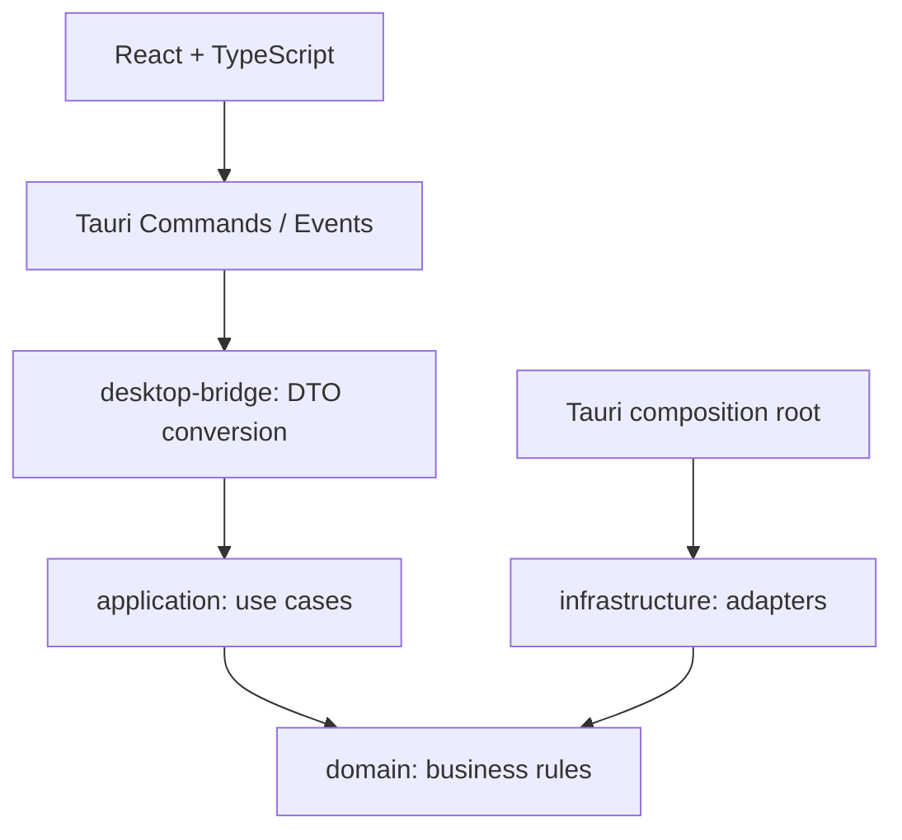

# MediaAtlas 架构与版本化 IPC

本文保留当前分层、接口和权限边界。产品流程见 [自动媒体库](automatic-library.md)和 [Emby 流程基准](emby-scraper-workflow.md)，详细接口见 [文档索引](README.md)。阶段编号用于识别协议来源，不作为开发前置审批或验收成绩。

## 分层与依赖



箭头表示依赖或调用方向。`apps/desktop/src-tauri` 是组合根：初始化日志和后续基础设施，将适配器注入应用服务，注册 command/event。它不承载媒体匹配或采集业务。

| 位置 | 职责 | 边界 |
| --- | --- | --- |
| `apps/desktop/src/` | React UI、路由、typed IPC、展示状态 | 不直接访问刮削站点，不包含 Provider 密钥，不拼 SQL |
| `apps/desktop/src-tauri/` | Tauri 窗口、权限、command/event 注册和平台能力 | 仅适配桌面宿主；不实现媒体规则 |
| `crates/domain/` | 值对象、领域错误和后续独立媒体模型 | 不依赖 Tauri、HTTP、SQLite 或 React |
| `crates/application/` | 应用信息及后续 use case、输入快照和应用 DTO | 调用领域和显式端口，不读取 UI 全局状态 |
| `crates/infrastructure/` | 日志及后续数据库、网络、文件系统适配 | 通过应用/领域边界提供能力，不反向调用 UI |
| `crates/desktop-bridge/` | 可独立测试的 IPC DTO 和错误转换 | 不依赖 Tauri；宿主将其接到 Tauri 命令与事件 |

核心分为四个 core crate 与独立只读 `media-scanner`，刮削和输出服务按实际职责组织。新增 crate 需要真实依赖隔离或复用需求，不预建业务空壳。详见 [ADR-001](adr/ADR-001-tech-stack.md)。

## Phase 0 冻结接口

JSON 字段使用 `snake_case`。Rust 内部结构不直接作为 UI 契约；Rust/TS 侧的契约测试固定以下形状。

### 命令 `get_app_info`

无输入、无磁盘或网络业务副作用。返回真实构建信息：

```json
{
  "schema_version": 1,
  "app_name": "MediaAtlas",
  "app_version": "0.1.0"
}
```

`app_version` 由构建包版本提供，示例版本不是运行环境探测结果；workspace、Tauri 和前端包版本应一致。此命令不返回媒体数量、Provider 状态或虚构数据。普通浏览器预览缺少 Tauri 时应显示明确提示，不伪造 IPC 成功。

### 错误协议

Tauri command 失败通过 Promise rejection 返回可序列化对象：

```json
{
  "schema_version": 1,
  "code": "internal_error",
  "message": "The request could not be completed.",
  "correlation_id": "request-correlation-id"
}
```

`code` 为稳定的 `snake_case` 标识；`message` 为可显示且经过脱敏的文本，不包含凭据、原始路径、内部堆栈或站点原文。`correlation_id` 只用于关联诊断，不能编码用户数据。UI 按错误码显示本地化文案；不依赖 message 文本分支。仅在真实错误出现时返回失败，不为演示制造业务错误。P0 最小错误分类由实现和契约测试固定；后续按能力增加，不能将所有错误都归为成功或空结果。

### 事件规则

P0 UI 仅通过 `get_app_info` 完成握手。宿主启动时可发送应用就绪诊断事件 `app-ready`，载荷与 `get_app_info` 相同，不伪装任务进度。该事件可能早于 UI 订阅，不保证 P0 UI 接收，也不要求 UI 先监听再请求信息；`get_app_info` 是应用信息的可重取来源，不能依赖启动事件必达。

持久化任务使用 `task-created`、`task-updated`、`task-log`、`task-needs-review`、`task-completed`。任务载荷必须包含 `schema_version`、任务 ID 和关联 ID，具体字段在 P2 DTO 审查时冻结。事件更新 Query 缓存或触发重查，不再建立一份重复媒体数据库。

### 版本规则

- `schema_version` 是协议版本，与 `app_version` 分开。
- 同一 schema 内只增加可选字段，消费者忽略未知字段；必需字段改名、删除或类型变化须增加 schema 版本并更新两端契约测试。
- 接收方拒绝不支持的 schema，不把未知形状强转为成功结果。
- 事件、错误和命令响应均采用明确 DTO；对外 DTO 在对应阶段先于实现冻结。

## 日志与隐私

后端使用 `tracing` / `tracing-subscriber`，以结构化字段记录生命周期、稳定错误码和关联 ID。生产日志写入应用数据目录并滚动保留；开发控制台输出不能改变脱敏要求。

默认采用允许字段列表，不整包记录 command 输入、HTTP headers、Provider 配置、元数据或调试结构。Cookie、Authorization、Token、API Key、邮箱、敏感 URL query 和用户目录片段不得进入日志。错误详情保留在受控诊断边界，向 UI 返回稳定错误码及脱敏消息。日志和脱敏应可独立测试；P3 引入网络时另测 URL/请求/响应日志。

日志、网络、凭据和诊断分别验证脱敏边界；本地 Mock 测试不证明真实来源或系统凭据服务已通过。

## 后续业务边界

- 媒体库以本地可用文件为索引基础。添加目录后后台扫描、索引并补全唯一可靠匹配；歧义留待人工核对。远端候选不能替代本地文件，资料缺失不隐藏已发现的本地资源。
- Movie/TV、Anime、JAV、Music 使用独立扩展模型和类型专属匹配策略；统一公共身份、文件、图片、外部 ID 和字段来源。详见 [ADR-003](adr/ADR-003-media-model.md)。
- 全部采集在 Rust 后端，经 API + HTTP/HTML 双引擎执行；不使用浏览器自动化抓取。详见 [ADR-002](adr/ADR-002-dual-engine.md)。
- SQLite Repository 隔离持久化，迁移和模型先设计后实施。详见 [ADR-004](adr/ADR-004-database.md)。
- 文件写入、标签修改、移动或重命名均先生成 Preview/Diff，再由用户确认执行；默认 Preserve。首次 NFO/图片输出前就实现这一机制，不能等到 P7。
- 成人入口默认关闭，独立 Root、搜索和缩略图缓存；普通媒体墙、统计和最近访问默认不泄漏成人内容。

## 实施与验收边界

本文说明接口和依赖方向，不构成通过声明。每次变更重新运行适用检查；平台编译、原生运行与安装结果分别记录，见 [发布矩阵](release-matrix.md)及[截图记录](../screenshots/README.md)。

## P4 typed scraping and output boundary

`infrastructure::video_providers` contains fixed-endpoint TMDB/AniList/Wikipedia adapters over the P3 NetworkEngine. `domain::scraper` keeps Movie/TV/Anime queries, candidates and details tagged independently. `infrastructure::scraper` owns persistent immutable jobs/candidates/details, ID/year/alias matching, backend-generated merge diffs and atomic protected-field confirmation; confirmed type-specific source snapshots remain accessible from library details. No provider result gives the UI filesystem authority.

`provider_auth` stores only method/storage/revision references in SQLite; secret input is inbound-only and values remain in OS credentials or explicitly selected session memory. Per-revision references prevent an old job from picking up a newly saved account/method. Network secret query parameters are applied only to actual requests and query-auth redirects across origins are rejected. `media_output` owns separate persistent Preview/execute/discard with capability-confined create-new sidecars, unchanged source media, XML preservation, bounded image decoding/hash cache and platform source-identity safeguards. See [P4 contract](phase-4-contract.md), [provider access](provider-access.md) and [output details](media-output.md).


## Phase 5 adult capability boundary

Adult commands form a separate backend lane. The frontend uses one enabled resource type and shared routes; it automatically acquires the backend session grant after the saved setting enables the type. No separate unlock/lock UI is exposed. Persistent preferences do not themselves replace the process-local revocable grant. Ordinary queries, stats, tasks, provider snapshots and Inspector exclude adult records even while unlocked. Dedicated adult search/detail/merge/browse/output/batch commands require the grant and recheck it after asynchronous reads and before write commits/publication. Lock cancels in-flight adult requests, including requests tied to completed runs; invalidates unfinished output intents durably; and releases revoked platform leases. Adult roots cannot overlap ordinary roots through product root management. Adult cache directories and frontend query keys are separate. Credentials remain Settings→keyring/session references, never UI-editable opaque authority. See [adult contract](phase-5-contract.md).

## Phase 7 local consumption and review tools

Library consumption and tools have separate query scopes. Consumption requires an authorized playable local file association; metadata completion is an independent health state, not a visibility gate. Remote Music editions without linked local tracks remain in tools. SQL applies local availability and privacy predicates before pagination; tool cursors and consumption cursors cannot be interchanged. Poster cards navigate to details; an explicit action requests the current OS file association through an ID-only typed backend command. Multiple versions/Parts require file selection. There is no embedded player, transcoder, FFmpeg runtime or media server.

`organization` owns immutable source/target/attachment snapshots, streaming byte hashes, no-follow capabilities, no-clobber filesystem publication, per-stage persistent intent/completion logs and separately confirmed rollback. Filesystem changes and SQLite commits cannot be atomic together; retained owned staging/quarantine bytes and journal identity provide explicit recovery evidence. Startup only marks interrupted work. The ordinary/adult channels remain separate; revoked adult previews cannot be revived by unlocking.

`watcher` uses maintained native `notify` handles, durable opt-in settings, bounded event queues, debounce and coalescing. For explicitly opted-in ordinary directories it feeds the existing backend automatic update pipeline; source files remain read-only and no event authorizes sidecar output or file organization. Process lifetime and persisted configuration are distinct. `health` performs bounded read-only maintenance review and navigates to explicit tool workflows. App-private quarantine/backup names are excluded without changing the existing user hidden/Git/exclusion semantics.

## 持久化人工核对

P0 人工核对账本通过版本化 IPC 和 `ReviewQueueService` 管理，schema 19 追加队列、项和不可变预览检查点。它只用于普通影视；成人/音乐不进入该账本。客户端恢复显式读取状态，写入使用 revision CAS，确认由真实后端合并成功证据证明；读取、跳过或切换不授予写盘权限。详见 [核对队列契约](review-queue.md)。本轮检查与新截图仍需在集成完成后记录。
