# 对照 Emby Server 与成熟刮削工具的流程改进

> 当前 P0：[逐项核对队列与恢复契约](review-queue.md)已实现并重新验收；本轮前端 397 项、Rust 343 项测试通过，[新截图与限制](../screenshots/review-queue-2026-11-04/README.md)单独记录。下方更早结果仍属于注明的基线。

调研日期：2026-11-04（北京时间）。代码基线：`acd5c37`。采用官方文档和本仓库代码对照，没有运行这些第三方应用。本文以 Emby Server 成熟的媒体库工作流为主要参考，结合 Jellyfin、MediaElch、tinyMediaManager 和 beets，区分已有实现、本轮改动与后续计划。

**采用的主线：默认自动发现并补全可靠资料；有问题时按原因处理当前媒体；磁盘文件修改独立预览和确认。**

## 1. 参考证据与取舍

| 来源 | 核对到的行为 | MediaAtlas 的取舍 |
| --- | --- | --- |
| [Emby：Library Setup](https://emby.media/support/articles/Library-Setup.html) | 以内容类型、名称和可视化路径选择配置媒体库；高级设置另行展开，也保留手动网络路径 | 继续让选目录成为主入口；名称自动建议、类型由用户确认；备用路径与高级参数折叠。多个物理路径组成同一逻辑库是后续能力，当前 Root 仍是单路径 |
| [Emby：Metadata Manager](https://emby.media/support/articles/Metadata-manager.html) | 媒体上下文可识别、更正；刷新可以补缺或替换，锁定字段保护人工修改 | 将缺来源、处理中、歧义与请求失败分流；保留原有就地识别，更正不能绕过手改/锁定保护。不照搬覆盖全部及替换自定义图片 |
| [Emby：Scheduled Tasks](https://emby.media/support/articles/Scheduled-Tasks.html) | 耗时维护任务与常规扫描分开，触发条件可配置，也可手动运行 | 保留后台工作、可查询状态与取消。定时策略不能等同“启动就扫全部盘”，当前不新增调度器 |
| [Jellyfin：Libraries](https://jellyfin.org/docs/general/server/libraries/) | 目录可视化选择，内容类型明确；不推荐依赖混合类型得到稳定识别结果 | 类型不是装饰字段；不静默猜成 Mixed，也不强制改名搬文件 |
| [Jellyfin：Metadata](https://jellyfin.org/docs/general/server/metadata/) 与 [本地 NFO](https://jellyfin.org/docs/general/server/metadata/nfo/) | 来源有差异和可达性限制；本地 NFO 可参与资料读取且有自身优先级 | 区分“已保存认证、已启用、实际请求成功”；保留本地资料优先和字段保护。不能因为保存 Token 就显示刮削完成，也不能将所有来源错误都当缺凭据 |
| [MediaElch：Movie](https://mediaelch.github.io/mediaelch-doc/movie/index.html) | 从媒体列表筛选和选中对象，再选择候选与抓取字段；提供键盘操作 | 常见异常要能直接筛出；纠错复用当前媒体身份及字段预览，避免要求记住内部 ID |
| [tinyMediaManager：Quickstart](https://www.tinymediamanager.org/docs/quickstart) 与 [电影设置](https://www.tinymediamanager.org/docs/movies/settings) | 数据源发现与网络刮削是不同过程；来源、语言、图片与自动任务各有配置 | 默认自动串联发现与可靠匹配，但结果分别显示。本地浏览不被线上资料阻塞；后续可补目录级策略，不把其强制最佳匹配或自动重命名作为本项目默认 |
| [beets：Configuration](https://docs.beets.io/en/stable/reference/config.html) | 有增量、恢复及弱推荐时暂缓的可配置策略 | 借鉴可恢复和“不确定先暂缓”的原则。音乐匹配距离不直接用于影视，不虚构识别准确率；启动恢复不能自动重放文件修改 |

这些来源提供交互与流程依据，不表示各工具的功能、默认配置或商业版本完全相同。没有引入其代码、依赖、播放器、转码器或自动文件整理行为。

## 2. 用户应当怎样使用

```mermaid
flowchart TD
    A[添加目录：选文件夹和类型] --> B[检查来源就绪状态]
    B -->|可用| C[后台扫描与本地收录]
    B -->|尚未配置| D[先浏览本地文件，明确资料未获取]
    D --> E[设置：手动保存认证并明确启用]
    E --> C
    C --> F[海报墙显示本地媒体]
    C --> G[可靠匹配及补全应用内资料]
    G -->|完成| F
    G -->|需要核对| H[仅查看待核对媒体]
    G -->|请求失败| I[仅查看资料获取失败的媒体]
    H --> J[当前媒体详情：识别或更正]
    I --> J
    F --> K[详情：系统应用打开]
    J --> L[选择正确候选和字段后确认]
    L --> F
```

日常只需添加目录和浏览媒体。来源配置通常只在首次、切换来源或认证失效时发生；人工纠错只处理有问题的条目。查看进度不是必经步骤，NFO/海报输出也不是浏览媒体的前提。

### 首次添加

1. 在媒体库点添加目录，直接选文件夹。
2. 确认名称和内容类型。来源就绪检查只说明配置条件，不声称已经连通或刮削成功。
3. 可以先收录本地文件；也可以先保存目录并进入来源配置。后者保存认证、明确启用后，更新同一个真实目录并返回其媒体库，不要求重新添加目录。
4. 离开页面不会停止后端处理。实际完成、待配置、待核对和请求失败分别显示。

### 日常维护与纠错

| 我遇到的问题 | 正确操作 | 不应该发生 |
| --- | --- | --- |
| 新增文件 | 对该目录执行更新，或使用已经明确启用的监听 | 为每次新增内容重建目录 |
| 来源未配置 | 在列表或详情直接配置来源；只有目录范围明确时才承诺继续该目录更新 | 进入不可检索的工作台，或把收录成功当资料完成 |
| 多个可能候选、识别错误 | 筛出待核对媒体，在对应详情识别/更正；检查名称、年份、ID与字段预览 | 自动接受第一个模糊候选或为了纠错搬动源文件 |
| 网络请求失败 | 筛出失败条目，检查原因及现有网络诊断，再选择重试 | 要求重新添加目录，或给所有问题都显示“重新填 Token” |
| 缺海报 | 用缺海报筛选定位；保留已有身份和人工字段，按现有更新/识别能力处理 | 将缺图等同于文件不存在，或自动覆盖自定义图片 |
| 资料看起来正确 | 浏览并交给系统关联应用打开 | 强制再刮削、确认“入库”或生成旁车 |

## 3. 本轮改进与已有能力

### 已有基础，继续保留

- 海报墙为默认入口，目录直接选文件夹；来源、网络和诊断归设置标签。
- 后台索引与可靠资料匹配；本地文件先可见。真实任务结果持久化，缺来源有独立计数；离开页面不会取消任务。
- 手动 Token 保存、明确启用和继续原目录更新的链路。
- 详情已经有识别/更正入口；已有单项候选、外部 ID、字段预览和保护规则，不重复新建另一套编辑器。
- 普通/成人查询与缓存边界、关闭分类后的清理、只读源文件和系统应用打开。

### 本轮落实的改进

1. **海报墙提供常见处理快捷筛选。** 复用完整库的服务端健康过滤，不只筛当前页；不展示没有查询依据的数量。“全部”只取消健康状态限制，保留目录、类型、检索等上下文。类型切换后不把普通在线状态带进不支持它的通道。
2. **详情中的缺来源直接进入配置。** 从当前媒体的真实文件关联确定目录；只有唯一有效目录时才承诺继续更新。剧集子项映射到来源支持的配置类型，身份和隐私边界保持不变。处理中给出状态，不能让用户在后台正在获取资料时误以为需要重复识别。
3. **更新结果直接定位问题集合。** 普通媒体待核对操作带 `metadata_needs_review`，失败操作带 `metadata_failed`，保留唯一目录范围。不会把用户丢回全库清单，也不会将来源未配置和真正的匹配歧义混为一类。

4. **扫描失败有对应下一步。** 目录不可用、排除规则和本地资料错误只使用安全白名单解释；未知错误不输出原始内容。取消/中断明确已有收录和资料保留，可再次更新目录，实际重试调用已有目录更新接口，不宣称只重试失败条目。

实现范围以本轮源码和最终验收记录为准；下节项目不因为写进文档就视为完成。

## 4. 后续优先级与验收门槛

| 优先级 | 下一步 | 可交付的验收条件 |
| --- | --- | --- |
| P0 | 从问题条目重试到结果返回的更完整闭环 | 明确区分认证、限流、超时、无结果；保留原媒体/筛选；取消有效，迟到响应不恢复旧画面。只重试已有后端真正支持的范围，不让“仅失败重试”按钮调用全库重抓 |
| P0 | 手动核对队列的持久账本与返回位置 | 已确认、暂缓、失败可查询；重启后显式继续；返回原清单不丢有效查询。不得自动重放确认、输出、移动或覆盖 |
| P1 | 目录级来源顺序、资料语言、图片策略 | 先增加后端持久契约与实际生效证明，再提供界面；来源不支持的选项禁用或明确回退，不只有漂亮的配置表单 |
| P1 | 明确范围的“补缺资料/图片”更新 | 先定义每项结果、幂等与取消；已有身份不重新模糊匹配；保护手改、锁定及已有图片。当前目录更新不冒称具备 Emby 的所有刷新模式 |
| P1 | 可配置监听、定时扫描与离线盘策略 | 不影响首屏；显示真实触发条件；离线目录可重试但不当作用户删除；成人授权按后台能力单独核验 |
| P2 | 多个物理路径组成同一逻辑媒体库 | 数据库、去重、权限、根目录变更及删除语义先完备；不靠前端把几个 Root 改成同名就宣称实现 |
| P2 | 目录结构/命名诊断与重复版本比较 | 提供准确可解释的冲突信息；不把建议命名变成强制重命名，不以同名作为删除依据 |

### P1 实施前的能力审计（尚未实施）

本轮只读核对确认：

- [RootInput / RootView](../crates/application/src/library.rs) 只有名称、路径、类型、启用及排除规则，没有目录级来源顺序、资料语言或图片策略。全局 ProviderConfig 的启用/认证引用/限流配置不能冒充目录策略。
- [普通自动匹配](../crates/infrastructure/src/scraper/automatic.rs) 对电影/剧集固定 TMDB、动画固定 AniList；每种类型只有一个自动来源，当前添加“来源排序”界面没有实际意义。[成人自动匹配](../crates/infrastructure/src/adult_scraper/automatic.rs) 按真实命名空间选择 `dmm.product → dmm` 或 `wikidata.catalog:* → wikidata`，二者不是可互换的模糊兜底来源，不能跨发行/身份范围回退。
- 普通和成人自动查询目前请求 `zh-CN`，不等于来源返回中文。AniList 中文请求实际可能返回 `ja-Latn`（见 [适配与回归](../crates/infrastructure/src/video_providers.rs)）；Wikidata 当前 SPARQL 使用 `ja,en`，DMM 保留来源原文。描述符中的 languages 不是翻译或所有字段语言支持承诺。
- 按用户最新授权，本地有效 NFO 不限生成工具并优先读取；缺失时自动刮削并生成 NFO，已确认资料可以在更新时补生成缺失 NFO。已有 NFO 和手改/锁定字段保留；NFO 写入失败与资料获取分开显示，源媒体仍只读。封面仍受当前可见权限和已有图片保护。音乐自动流程读取本地标签，不代表已有在线自动音乐刮削。

后续顺序应为：目录策略的后端持久化与 revision → 任务不可变快照 → 适配器实际生效 → requested/effective language 与回退可观测 → 权限、保护、迁移回归 → 最后接入 UI。`provider_order`、`metadata_language`、`artwork_mode: missing|none` 仅是待审查的 P1 字段提案，本轮没有添加这些目录字段或声称 P1 已完成。

## 5. 状态与权限底线

“文件存在”“已加入应用索引”“来源已配置”“已得到可信资料”“已生成旁车”是五个不同事实。页面的标题、计数、主要操作和失败恢复都必须对应实际事实；不能只用一个绿色成功覆盖全部阶段。

自动识别继续采用可核验身份或唯一可靠匹配；手动核对处理歧义。更新应用数据库/缓存不等于授权写入媒体盘。Emby 的全量替换、tinyMediaManager 的自动重命名等能力不会原样照搬。

成人在界面只是资源类型，但后台独立授权与缓存不变。未知或多目录范围不猜测；成人目前不支持的 `metadata_*` 查询条件不会向后台发送；完善该类型的精确异常集合与后台进度仍是后续工作，不能用前端假筛选补齐。音乐当前自动流程读取本地标签，不借文档暗示已实现新的在线自动音乐刮削。

## 6. 本轮验证

完成后记录适用的 `pnpm check`、快捷筛选/详情配置/问题集合导航行为测试，以及 1648×928、窄屏、键盘、减少动态、加载/空/错误/缺图的实际截图。浏览器测试使用显式 fixture，不能代替原生目录选择、系统 keyring、实时来源或安装验收。没有新增后端契约的改动，不以重复历史 Rust 成绩作为本轮前端通过证据。

本篇和 [自动媒体库](automatic-library.md) 是当前采用的自动主线；已被替代的旧研究、阶段成绩与操作指南已移除。保留的阶段契约仅用于其仍生效的数据、IPC 和权限边界。

### 已验证的上一轮执行结果

- `pnpm check`：lint、typecheck、43 文件 / 346 项测试、生产构建全部通过。
- 新增及调整的行为验证涵盖完整服务端筛选、游标复位、普通/成人查询边界、详情真实目录范围、扫描错误白名单、取消和中断恢复。
- 实际 Chromium 专项通过，保存六张本轮截图；原有主流程完整回归也通过（输出在本地 work/community-baseline，不覆盖历史截图）。见 [本轮图文验收](../screenshots/community-flow-2026-11-04/README.md)。
- 本轮未改 Rust 后端或锁依赖，未重新声称原生宿主、真实 Provider 或安装验收通过。没有移动版本 tag，也不等待桌面打包。

### 第一阶段 P0 已交付

已实现 [持久化人工核对队列](review-queue.md)：暂缓/失败/已确认账本、恢复与筛选返回、同媒体预览检查点、最终事务权限重验，以及按真实失败类型提供显式下一步。本轮前端 397 测试、Rust 默认工作区 343 测试、构建/Clippy/格式通过；浏览器十组场景通过。目录级来源/语言/图片策略仍是上节 P1 能力审计与后续实施项，不宣称已实现。
