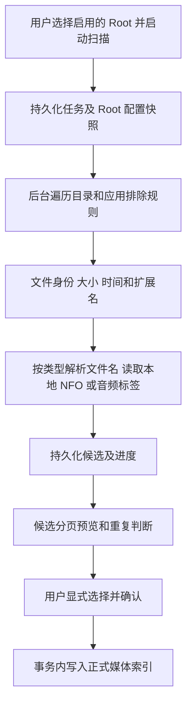

# Phase 2 本地媒体库工作流

社区实践、当前实现对照和后续优化优先级见 [社区刮削工具实践与 MediaAtlas 后续优化](community-scraper-best-practices.md)。

> 当前默认工作流已按用户要求改为 [自动媒体库](automatic-library.md)：添加普通目录即后台扫描、索引并自动补全可靠匹配资料，本地媒体先显示；下面 P2/P7 的手动确认与可信资料可见规则保留作历史设计，发生冲突时以新工作流为准。真实媒体文件仍只读，旁车/组织操作保留明确确认。

状态：Phase 2 实施设计。基线见 [原始计划](UNIVERSAL_MEDIA_SCRAPER_AGENT_PLAN.md)，共享边界见 [phase-2-contract.md](phase-2-contract.md)，界面见 [ui-spec.md](ui-spec.md)。用户已明确授权启动 P2；保留 P0 平台启动和 P1 远端 CI 尚未确认的记录，不将其改写为通过。

## 范围与边界

P2 实现 Root 管理、本地扫描、候选预览与确认入库、持久化扫描任务、真实媒体库查询和界面。媒体来源只限用户选择的本地 Root，不访问在线 Provider，不下载海报，不实现文件系统 Watcher。所有媒体文件、字幕、NFO 和音频标签只读；扫描不会移动、重命名、删除、修改标签或生成旁车文件。

SQLite、任务记录和应用缩略图缓存可以写入应用数据目录。Root 选择不能被当作通用文件写入授权。移除 Root 或媒体仅删除索引和关联记录，不删除磁盘上的源文件。

## Root 管理

用户指定名称、绝对目录和媒体类型，设置启停及排除规则。Mixed 仅可显式选择，不作为默认猜测。Root 的平台身份延续 P1 的 PathStyle 和规范化规则；已有文件时不允许无声改变平台语义。

Root 保存与扫描是两个操作。新增 Root 不自动发起扫描；禁用 Root 后不能启动新扫描。编辑 Root 路径、类型或排除规则时，既有任务仍使用创建时的不可变配置快照，不能把运行结果写入用户后来选中的目录。移除有活动任务的 Root 必须先取消任务或明确拒绝操作。

成人 Root 独立管理，普通 Root 列表、Dashboard、媒体查询和任务预览默认排除成人内容。只有用户明确开启成人显示后，相关查询才带显式的 adult 可见性参数；关闭后清除对应页面选择和 Query 缓存，不保留封面泄漏。

## 扫描与候选

扫描基于 `root_id + normalized_relative_path` 标识文件。原始相对路径保留展示；大小和修改时间用于增量判断。已确认且未变化的文件标记为 unchanged，不产生重复 MediaItem。已变化的文件重新生成预览；不能仅凭文件同名、大小相同或模糊标题将不同文件合并。

目录遍历在后台执行，不占用 UI 线程。持续检查取消信号，定期持久化进度并发送版本化事件；不为每一个文件创建完整前端对象或事件风暴。候选按页返回，10,000 文件扫描不能导致前端一次接收全部候选。

目录符号链接、不可读取条目、不受支持的媒体和无效路径必须有明确策略及警告。不能沿符号链接离开 Root 再读取外部目录；候选确认时复核 Root、相对路径和文件身份，拒绝过期或被替换的候选。

## 类型识别和本地元数据

- Movie：标题、年份、Part/CD、版本/分辨率识别；同一作品的多 Part 可以归组，不能因相同标题跨年份盲目合并。
- TV：识别 `S01E01`、`1x01` 等季集模式，保存 Series/Season/Episode 关联。绝对集数独立保存，不强制转换成假季号。
- Anime：保留字幕组/别名和绝对集数线索，基础实体可关联 TV/Movie；无法可靠确定类型或季集关系时进入 needs_review。
- JAV：仅在独立 AdultVideo 类型或 Root 上应用番号识别；保留原始番号、命名空间和 Part 线索，不混入普通电影字段。
- Music：读取支持格式的本地标签，保留 Artist/Album/Disc/Track/Recording 线索；P2 不写标签，不接 MusicBrainz，不提前构建 P6 在线音乐工作流。

可读本地 NFO/标签/外部 ID 优先于文件名猜测。NFO/XML 必须拒绝外部实体和 DTD，不访问文件引用或网络引用，并限制旁车读取大小。无效 NFO、无效图片和标签解析失败形成局部警告，不能把整个 Root 的扫描伪装成成功或直接停摆。

不确定候选应明确显示原因，由用户决定是否确认；不会自动把 needs_review 当作确定匹配。任何 Fixture/Demo 来源仅用于开发和测试，并明确标记。

## 预览确认与幂等

扫描结果先进入独立候选集合。只有用户提交的当前任务候选 ID 可以入库；空选择、其他任务的 ID、未完成或已取消任务的非法确认均须明确拒绝。确认在数据库事务中完成，避免部分写入导致文件孤儿或重复条目。

重复确认同一候选应返回 unchanged 或既有结果，不重复创建媒体。确认期间保留 P1 字段来源、人工修改和锁定语义；本地读取不是覆盖用户编辑的授权。多 Part、季集关联和本地旁车元数据的归组身份应可重用且可测试。

确认只写索引和所需应用缓存；不写 NFO、标签、海报旁车，不默认整理原视频。候选记录与任务进度均可在重启后读取，不依赖进程内缓存作为唯一事实来源。

## 持久化任务与恢复

任务状态使用基线 `Queued`、`Running`、`WaitingForUser`、`Succeeded`、`Failed`、`Cancelled`、`Interrupted`。扫描完成且存在待确认候选时进入 WaitingForUser；确认后按剩余候选与结果确定最终状态。状态更新需要合法转换，不将终态任务无声恢复成运行中。

取消要停止遍历并持久化 Cancelled；已持久化的候选不得继续自动入库。应用启动时将遗留 Running 任务标记 Interrupted，展示原因并允许用户显式重新扫描；不自动重放任何文件计划。事件只作为刷新提示，重连后可从数据库重新查询任务状态。

## 查询与健康

媒体库提供服务端分页、搜索、类型/Root、健康过滤、Facets 和排序。海报墙与列表共享同一查询语义和当前选择；切换视图不重新下载所有图片或一次载入全部记录。健康状态至少能表达缺海报、缺 NFO、元数据不足及重复风险；没有资料的 Facet 不编造值。

详情从正式本地索引读取文件、外部 ID、来源、图片和关系，不把 Provider 搜索候选当成媒体库条目。本地可用海报优先生成/读取应用缩略图；缺失图片显示明确占位，不补虚构在线海报。

## 验收证据

- Fixture 目录扫描→分页预览→确认入库→列表/海报墙/详情查询完整闭环。
- 重复扫描、增量扫描、重复确认和多文件作品查询不产生重复条目。
- 取消、重启 Interrupted、解析局部失败、锁定字段保护、Root 外路径和符号链接边界测试。
- 1000 条媒体分页浏览、10,000 文件扫描进度与取消检查；明确记录实际执行平台及未验证项。
- Adult 默认隔离和关闭后的缓存清理；zh-CN/en-US 切换、恢复和文案覆盖。

## Phase 7 对早期展示行为的更新

P2 明确确认扫描候选只授权建立工具索引；它不代表裸文件名推断已经完成刮削。只读 Library 使用独立可信来源规则：明确确认的类型专属在线 metadata，或已确认导入的真实本地 NFO/音频标签，并要求当前可播放本地文件关联。历史本地 NFO 按实际安全读取与合法文档回填；不能仅凭 `provider_id=local` 推断完成。远端音乐发行图与未完成条目留在工具区，不冒充本地资源。Library 卡片主操作请求系统关联应用，详情是独立入口，多版本/Part 由用户选择。编辑、搜索/导入、标签、导出、组织、恢复和维护均在独立工具区进行。

Watcher 配置按 Root 显式开启，重启恢复配置后重新建立进程句柄；成熟 `notify` 事件经过有界队列、去抖、合并、溢出补扫及当前 Root 权限验证，复用 P2 同一候选预览流程。它不会自动确认候选、发起网络刮削或移动文件。锁定成人与 Mixed Root 不自动监控。应用隔离/备份目录排除不改变用户对普通隐藏文件、Git 文件或自定义排除规则的语义。

## 2026-11-03 社区实践与逐项核对

本轮在当前 main 增量实施，参考资料是实际开源实现与文档：

| 来源 | 核对到的行为 | MediaAtlas 的采用方式 |
| --- | --- | --- |
| [MediaElch 电影文档](https://github.com/mediaelch/mediaelch-doc/blob/master/docs/source/movie/index.rst)及[多影片刮削实现](https://github.com/Komet/MediaElch/blob/master/src/ui/movies/MovieMultiScrapeDialog.cpp) | 多选影片、队列、取消与字段选择 | 普通工具区多选后逐项核对，最多 32 项，不自动选首候选或写盘 |
| [tinyMediaManager README](https://gitlab.com/tinyMediaManager/tinyMediaManager/-/blob/devel/README.md)及[缺资料筛选](https://gitlab.com/tinyMediaManager/tinyMediaManager/-/blob/devel/src/main/java/org/tinymediamanager/ui/movies/filters/MovieMissingMetadataFilter.java) | 按实际媒体状态筛选，搜索和排序 | 目录、类型、健康、检索、排序进入真实后端查询；24 项分页，不能只过滤当前页 |
| [tinyMediaManager 刮削任务](https://gitlab.com/tinyMediaManager/tinyMediaManager/-/blob/devel/src/main/java/org/tinymediamanager/core/movie/tasks/MovieScrapeTask.java) | 逐项选择器、取消和覆盖策略参数 | 上一项/跳过/下一项及“返回媒体清单”；仅补空缺、全不选、全选未保护字段，继续保护手改/锁定值 |

查阅时 tinyMediaManager devel 的 HEAD 为 `e813864038d8f2bbed1428a714b81e3b317f5ac1`。只采用交互和状态管理思路，没有复制第三方实现代码、品牌或业务导航。

当前实现保留跨页有序选择，单项查看不清空批选；筛选或排序变化复位失效游标与选择。队列仅接受真实普通工具媒体 ID，严格校验参数并保留配置往返的队列顺序。第 i/n 项是导航位置，不是已处理进度；下一项只在当前项有真实确认结果时显示，否则提供跳过。确认或文件执行期间禁用队列切换。

所有选择和预设只是草稿；更改字段预设使未执行的合并/输出预览失效，回收输出租约。0 与 false 是已有值；锁定和手改字段即使为空也不自动选择。只有现有明确确认动作可以更新元数据或生成旁车，普通媒体库继续只读，成人业务不使用普通队列。

发布方面，本轮用户明确授权对 `v0.1.0-beta.2` 进行两次移动，覆盖此前“不移动 tag”的任务约束。先移动到上一轮成果 `23f61bd`，本轮检查和证据提交后再移动到新 main。重复 tag 的 CI 重新核对引用、完整产物和哈希；已有 Release 以草稿重建完整资产集合，旧任务不能按过期 tag 发布。移动 tag 本身不代表新安装包已经构建完成。
