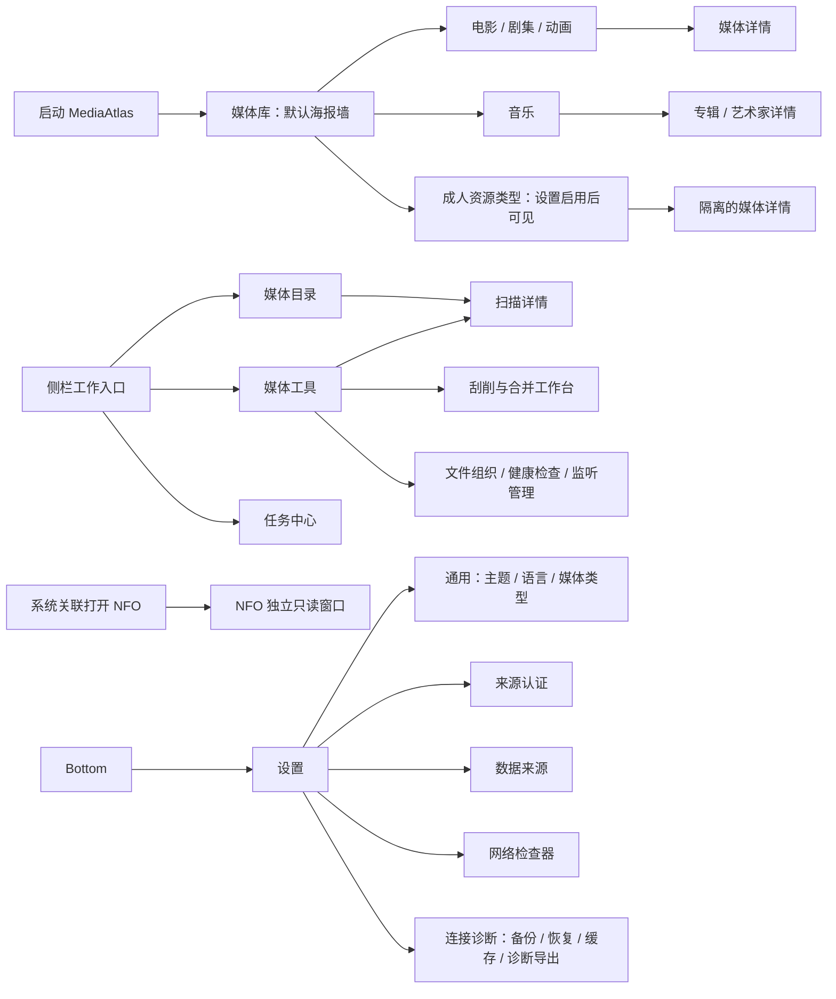
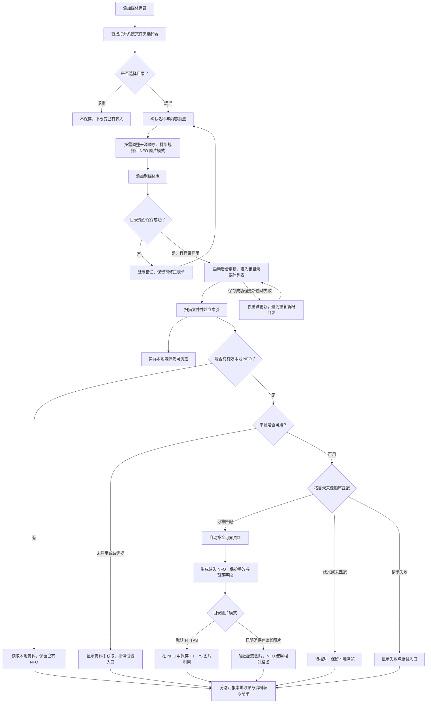
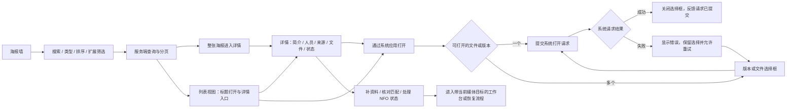
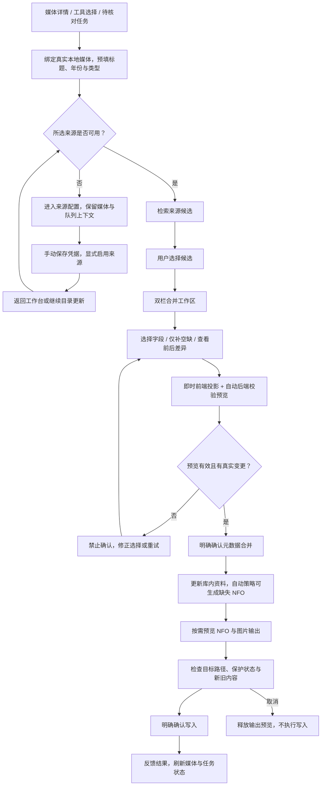
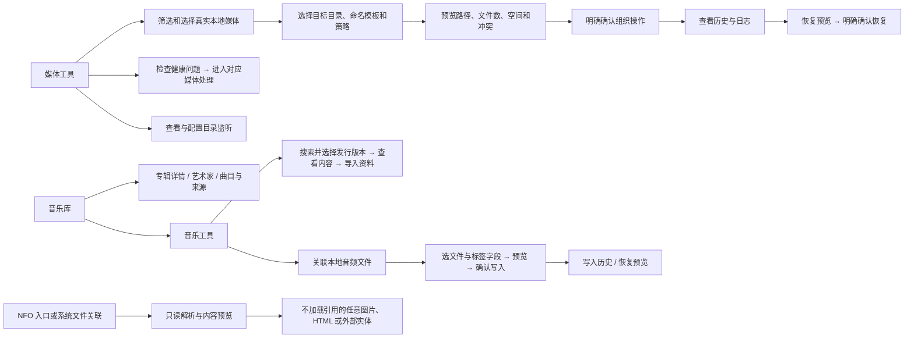
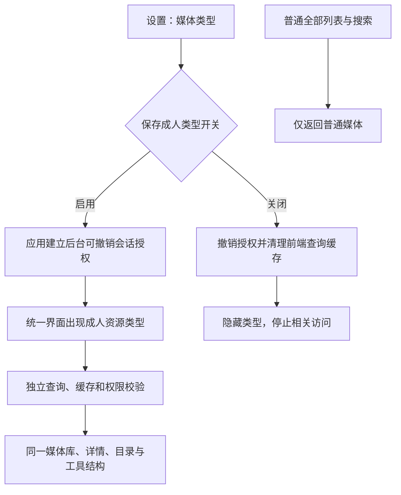

# MediaAtlas 产品流程与 UI/UX

更新：2026-11-06 · 流程整理基线：`b99533c`；本轮交互调整以当前工作区为准

本文按当前路由、页面和后台工作流整理；视觉参数引用仓库 `design.md`，不代表已经完成本轮视觉验收。

## 2026-11-06 主流程增量优化

研究范围是本地媒体管理桌面 App 的目录添加、浏览、详情和后台任务。沿用当前桌面布局、共享控件与用户已有截图；不以浏览器网页或播放器重建产品。

| 公开依据 | 当前代码中的问题 | 本轮处理 |
| --- | --- | --- |
| [GNOME 内容浏览规范](https://developer.gnome.org/hig/patterns/nav/browsing.html)要求一致的返回入口；[Jellyfin 社区反馈](https://www.reddit.com/r/jellyfin/comments/mgv02b)反映返回媒体库丢失滚动位置的摩擦 | 详情里的固定媒体库链接清空原筛选；按 URL 保存滚动位置会让相同 URL 的不同历史条目互相覆盖 | 使用真实应用历史返回，首次直达详情则回对应媒体库；滚动恢复使用框架历史条目键，保留原查询与分页 |
| [Jellyfin 筛选讨论](https://www.reddit.com/r/jellyfin/comments/1qf9hwk/filtering_was_one_of_my_biggest_pain_points_just/)指出难以清除条件；[GNOME Search](https://developer.gnome.org/hig/patterns/nav/search.html)要求明确空结果并支持搜索快捷键 | 无匹配结果时主要入口仍是目录管理；主搜索没有桌面快捷键 | 空结果直接清除搜索和细分条件，保留类型、目录、布局；Ctrl+F / Cmd+F 聚焦并选中主搜索，模态窗口内不抢焦点 |
| [tinyMediaManager 的电影面板](https://www.tinymediamanager.org/docs/movies/moviepanel)将选择条目查看详情与文件操作分开 | 海报点击看详情，列表标题却启动系统应用 | 列表标题统一进入详情，系统打开保留明确动作 |
| [GNOME 进度反馈](https://developer.gnome.org/hig/patterns/feedback/progress-bars.html)强调非阻塞反馈；[tinyMediaManager 导入与刮削流程](https://www.tinymediamanager.org/docs/quickstart)区分本地收录和资料获取 | 正在进行和需要处理的任务混在历史日志中，目录更新时缺少直接查看任务的入口 | 任务中心提供全部、进行中、待处理筛选和真实计数；更新中目录可直接查看任务，保留取消与恢复操作 |

以上社区讨论是定性案例，不代表用户占比或故障频率；是否适用以本仓库已确认的交互为依据。继续保持源文件只读、NFO 写入授权、成人查询隔离和手动凭据保存，不引入依赖或虚构进度。

验证边界：按用户要求只在本地静态读改，行为测试交由云端 CI；未启动本机应用、安装依赖或生成本轮运行截图。新版本发布另由四目标原生构建和包内检查验证；实机安装与视觉验收不由单元测试替代。

MediaAtlas 围绕本地媒体文件提供浏览、资料补全、核对和输出。日常路径是：**添加目录 → 后台收录 → 浏览海报墙 → 查看详情 → 通过系统应用打开**。缺少资料不阻止浏览，歧义和失败进入可处理状态。

## 1. 信息架构

| 入口 | 当前界面与行为 |
| --- | --- |
| `/` → `/library` | 默认媒体库，无概览页；海报墙与列表可切换 |
| `/media/$mediaId` | 媒体详情；成人资源通过类型上下文进入隔离查询 |
| `/music` | 音乐库；进一步进入专辑、艺术家和音乐工具 |
| `/roots` | 统一目录管理与添加表单 |
| `/tools`、`/tools?view=health` | 本地媒体工具与检查/监控；侧栏二级导航、窄屏横向导航保留视图 URL，选择媒体后按需展开文件整理 |
| `/scanner`、`/scraper` | 从目录、工具、详情和处理入口进入的工作页 |
| `/tasks` | 扫描与来源任务日志、状态、取消及恢复入口 |
| 系统关联 `.nfo` | 独立只读预览，不带应用侧栏和顶部工具栏；不再提供 `/nfo` 菜单入口 |
| `/settings` | 通用、来源认证、数据来源、网络检查器、连接诊断五个标签页 |

音乐目前属于媒体库侧栏分组。旧 `/adult` 等入口重定向到统一媒体库、工具和详情，不再形成独立成人中心；来源、网络和诊断没有旧式独立业务路由。

媒体工具本轮的公开实践、源码依据与验证边界见 [媒体工具 UI/UX 调整](media-tools-uiux.md)。

## 2. 添加目录与自动更新

- 手填路径和排除规则在高级配置中；选目录自动填名称，用户改名后保留其输入。
- 目录可以独立选择多个来源并排序；空来源列表只使用本地资料。目录设置不自动启用全局来源，也不保存凭据。
- 停用目录可保存配置，不立即启动后台更新。
- 有效本地 NFO 优先，不要求特定来源；已有 NFO 默认保留，不因后台更新再次自动刮削。
- 普通视频目录默认监听文件变化，尊重用户关闭监控的选择。已识别媒体删除 NFO 后，使用库内可靠资料按目录模式补回；待核对项和可选联网修图不阻断后续事件或补回。
- 离线图片授权只适用于明确保存该模式的目录和新生成的缺失 NFO；不为已有 NFO 补写图片，也不授权音频标签、移动或覆盖。

## 3. 浏览、详情与系统打开

浏览页默认保持紧凑：搜索进入顶部工具栏，类型、排序和视图切换位于控制行；目录、健康状态、类型标签、人员、制作方和年份等扩展筛选按需展开。筛选区不使用整块卡片底色，展开内容以细分隔线与紧凑字段组织。收起后仍显示已选条件和数量，每个条件可单独移除；移除仅清除该条件并复位分页，保留其他查询条件。筛选、排序、分页和视图由 URL 查询状态承载。

电影与剧集使用专门的详情构图；剧集呈现真实季、集和文件信息。其他类型沿用通用详情。评分、年份、简介、人员和图片来自实际资料，缺失时省略或显示明确缺失状态；不存在观看进度或“继续观看”数据。

系统打开的成功反馈只代表操作系统接收请求，不代表已经开始播放。

## 4. 人工刮削、合并与导出

| 工作区 | 用户看到和控制的内容 |
| --- | --- |
| 左栏 | 本地基础资料、当前补充来源、字段选择、仅补空缺 |
| 右栏 | 合并后的媒体展示、前后对比、逐字段明细 |
| 确认区 | 真实变更汇总；等待校验、失败、零变更或预览过期时不可确认 |
| 文件输出区 | 目的路径、受保护文件、新旧内容、执行与取消 |

- 确认资料合并与确认文件输出是两个操作。更新已有同名 NFO 需要用户主动再次刮削并确认导出。
- 字段锁定、手改保护和仅补空缺在最终写入时继续生效。
- 切换媒体或候选、取消与离开使未确认预览失效，晚到响应不能恢复旧选择。
- 普通视频可批选最多 32 项进入逐项核对；上一项、下一项、跳过不自动确认，不默认选首候选。另有持久化核对会话保存处理状态。
- 确认或写入期间禁止切换条目；来源设置往返保留当前媒体和队列。

## 5. 工具、音乐与 NFO 支线

日常浏览和自动更新保持源媒体只读。文件组织提供保留、移动、复制和硬链接策略，是独立的显式操作，必须先预览再确认；音频标签写入同样有独立流程，不由目录自动任务授权。

NFO 文件关联启动使用独立只读模式，不初始化媒体库、扫描或写入服务。音乐的发行版本资料导入与本地文件关联分开；导入资料不等于已拥有或关联本地音频。

## 6. 状态反馈与恢复路径

| 当前情况 | 界面反馈 | 下一步 |
| --- | --- | --- |
| 未添加目录 | 空媒体库 | 添加目录，直达系统选择器 |
| 有目录但暂无文件 | 与“无搜索结果”区分的空状态 | 查看更新状态或管理目录 |
| 正在扫描、索引或获取资料 | 后台活动与任务阶段、真实计数 | 继续浏览，按需查看任务 |
| 已收录但来源未配置 | 明确“资料未获取” | 配置凭据、显式启用并继续更新 |
| 有歧义或未匹配 | 待核对状态与处理入口 | 人工检索、选择候选、核对合并 |
| 来源请求失败 | 安全错误信息与可用恢复动作 | 重试、改检索条件或配置来源 |
| NFO 缺失或输出失败 | 独立 NFO 状态 | 管理目录、重试更新或按流程导出 |
| 图片缺失或加载失败 | 中性占位 | 仍可识别标题并进入详情 |
| 合并预览等待、失败或过期 | 禁止确认 | 等待有效校验或重新预览 |
| 系统打开失败 | 错误反馈，多版本选择可保留 | 重试系统打开 |

任务中心按时间、目录或来源、状态展示日志。自动任务进入待处理状态不等于本地资源不可浏览；本地收录数与资料匹配、待核对、失败数分别呈现，避免将索引成功表达成资料全部获取成功。

## 7. 成人资源的可见性与隔离

前端不增加成人中心、解锁页、锁定按钮或独立目录表单；可见性通过设置控制。统一入口不合并后台数据边界，成人资源不进入普通“全部”列表或普通搜索结果。

## 8. UI/UX 结构与视觉规则

| 层级 | 当前结构 / 仓库约束 |
| --- | --- |
| 窗口框架 | 固定侧栏，右侧内容独立滚动；侧栏底部保留 NFO 和设置 |
| 顶部工具栏 | 搜索、主题切换，以及宿主支持的窗口控件；媒体库内复用同一搜索状态 |
| 媒体库 | 标题与添加入口 → 后台活动 / 恢复状态 → 紧凑筛选 → 海报墙或列表 → 分页 |
| 媒体详情 | 媒体信息与主要动作优先；文件、人员、来源、健康状态等按内容分组 |
| 目录表单 | 系统选择器优先，名称与类型可见，高级路径与排除配置折叠 |
| 合并工作台 | 左侧选择与来源，右侧结果与差异，确认区给出实际后果 |
| 状态呈现 | Badge 表示状态；按钮执行动作。空、加载、错误、缺图分别处理 |
| 文案 | 用分组、对齐、间距表达结构；保留字段标签、真实元数据、错误与操作后果，删除重复介绍 |
| 控件与语言 | 复用仓库 shadcn 共享层，中文 / 英文使用现有 i18next |
| 视觉基调 | `design.md` 要求近黑默认主题、可保存的浅色主题、克制紫色强调、本地字体 |
| 响应与无障碍 | 规范要求窄屏侧栏收缩、可见键盘焦点、对话框焦点管理、减少动态效果、表格局部横滚 |

设计参考：侧栏约 228px，工具栏约 68–76px，海报比例 2:3，常用间距 4–32px，动画约 150–250ms。这些是响应式设计参考，不是固定坐标。

**当前页面与历史设计描述的区别：**默认媒体库是筛选加海报墙，不能将 `design.md` 中保留的 Hero、横卡和最近添加参考构图理解为当前首页已有的全部模块。详情页有专门媒体展示区域；本次未运行应用核对其最终视觉效果。

## 9. 本轮交互优化与社区依据

本轮优先解决筛选表单占据首屏、操作散落和输入时意外清空选择的问题。以下为已修改的代码行为，尚未运行或完成视觉验收。

| 区域 | 本轮调整 | 交互约束 |
| --- | --- | --- |
| 媒体库 | 轻量筛选栏；高级筛选移除大块底色和外层卡片感；已选条件可直接移除 | 保留类型、目录上下文与 URL 查询模型；单项移除复位分页，不重置其他条件 |
| 媒体工具 | 搜索、类型、排序和筛选入口组成紧凑工具栏；目录和健康状态按需展开 | 输入搜索词只修改草稿，Enter 或搜索按钮提交；重复提交同一查询不清空批选；提交新查询才复位游标、详情与选择 |
| 批量核对 | 已选数量、清空、队列操作和真实上限集中在一行 | 保留跨页选择、32 项限制、逐项确认和已有会话恢复；不将计数显示为处理完成数 |
| 扫描页 | 目录、最近任务和更新动作合并为紧凑选择区 | 不改变目录预选、任务识别、重试及后台更新行为 |
| 刮削页 | 去除目标与检索区的重复大卡片；标题优先，类型和年份使用匹配内容的宽度；高级检索使用轻量展开入口 | 来源配置状态和写入后果保持可见；只改变布局，不改变候选选择、预览或确认契约 |
| 共用筛选控件 | 复用仓库 shadcn Button、Input、Select，新增轻量 FilterBar / FilterChip | 展开状态有可访问语义；移除条件后焦点回到筛选入口；窄屏换行，条件摘要截断而不撑宽整页 |

采用的依据与适用范围：

- [NN/g：渐进披露](https://www.nngroup.com/articles/progressive-disclosure/)建议将较少使用的选项放到第二层。本项目将目录、健康和元数据筛选放在单层展开区；这不意味着把错误、权限或写入后果隐藏起来。
- [Carbon：Filtering](https://www.carbondesignsystem.com/building-blocks/core/patterns/filtering)要求折叠后仍提示已应用条件，并提供清除方式；本项目使用数量和可移除条件。搜索需显式提交是本项目对本地查询和批选状态的取舍，并非所有筛选一律增加“应用”步骤。
- [Carbon：Data table](https://v10.carbondesignsystem.com/components/data-table/usage/)将搜索、筛选及批量动作放在表格工具栏；本项目据此合并散落的批量操作，保留已有持久化核对会话入口。
- [苏格兰政府设计系统：Search filters](https://designsystem.gov.scot/patterns/search-results/search-filters)使用可移除的已选条件，并要求其可访问名称说明移除动作。本项目采用该交互，不复制政府站点的侧栏布局。
- [WAI-ARIA：Disclosure](https://www.w3.org/WAI/ARIA/apg/patterns/disclosure/)规定展开按钮的键盘操作与 `aria-expanded`；共用筛选栏用已有 Button 实现，不新增浮层依赖。

本轮未改后端扫描、NFO、来源启用或成人权限契约。工具页清除筛选继续保留当前资源类型，避免从成人类型意外切回普通查询；目录名称摘要使用与目录选项相同的隔离过滤。

静态审阅覆盖共用筛选栏、媒体库调用方、工具页搜索与批选状态、扫描及刮削布局、双语词条和现有测试调用。已补充或调整回归用例：草稿不发请求且保留批选、提交后复位分页、单项移除保留其他条件并恢复焦点、清除成人类型筛选后继续走独立端点。这些用例未执行。

## 10. 整理依据与验证范围

- 产品边界与视觉规则：[AGENTS.md](../AGENTS.md)、[design.md](../design.md)。
- 路由与应用框架：[app.tsx](../apps/desktop/src/app.tsx)、[app-shell.tsx](../apps/desktop/src/components/shell/app-shell.tsx)、[library-navigation.tsx](../apps/desktop/src/components/shell/library-navigation.tsx)。
- 浏览、详情与目录：[browse.tsx](../apps/desktop/src/features/library/browse.tsx)、[library-filters.tsx](../apps/desktop/src/features/library/library-filters.tsx)、[detail.tsx](../apps/desktop/src/features/library/detail.tsx)、[video-detail.tsx](../apps/desktop/src/features/library/video-detail.tsx)、[use-root-editor.ts](../apps/desktop/src/features/library/use-root-editor.ts)。
- 自动更新：[automatic.rs](../crates/infrastructure/src/scan_service/automatic.rs)；监听与 NFO 策略同时参照根产品约束和相关实现。
- 核对与输出：[scraper/page.tsx](../apps/desktop/src/features/scraper/page.tsx)、[merge-workspace.tsx](../apps/desktop/src/features/scraper/merge-workspace.tsx)。
- 工具与其他入口：[tools/page.tsx](../apps/desktop/src/features/tools/page.tsx)、[music/page.tsx](../apps/desktop/src/features/music/page.tsx)、[nfo/page.tsx](../apps/desktop/src/features/nfo/page.tsx)、[settings/page.tsx](../apps/desktop/src/features/settings/page.tsx)、[tasks.tsx](../apps/desktop/src/features/library/tasks.tsx)。

本次按会话要求只做静态阅读与代码、文档修改，没有运行桌面应用、测试、类型检查、构建、Mermaid 渲染或安装依赖。1648×928 与窄屏布局、键盘实机行为及明暗主题仍待运行验收；本文与测试代码均不能替代验证结果。
