> 历史走查（main / f34862c）：此处保留 2026-11-04 调整前截图。本轮已删除概览并调整媒体墙、目录及设置，最新验收见 [媒体墙与设置标签](../../screenshots/library-wall-2026-11-04/README.md)。

# MediaAtlas：我作为用户走一遍主流程

基于 main / f34862c · 2026-11-04（北京时间）· 当前实现记录，不是未来设计稿。

添加目录 → 自动处理、文件先可见 → 媒体库 → 详情 → 系统应用打开。进度查看可跳过；只有配置缺失或匹配有误才走支线。

> 全部为当前生产前端的真实 Chromium 截图，视口 1648×928；媒体、封面、扫描进度与识别结果使用明确标注的演示数据。未连接真实媒体盘、在线来源或 Windows 原生宿主。

[下载 PDF](MediaAtlas-user-flow.pdf)

## 01 · 打开应用，我先找到“添加目录”

**日常主线**。第一次打开时，媒体库是空的。我的目标是把已有文件夹交给应用，而不是先学习什么叫“入库”。

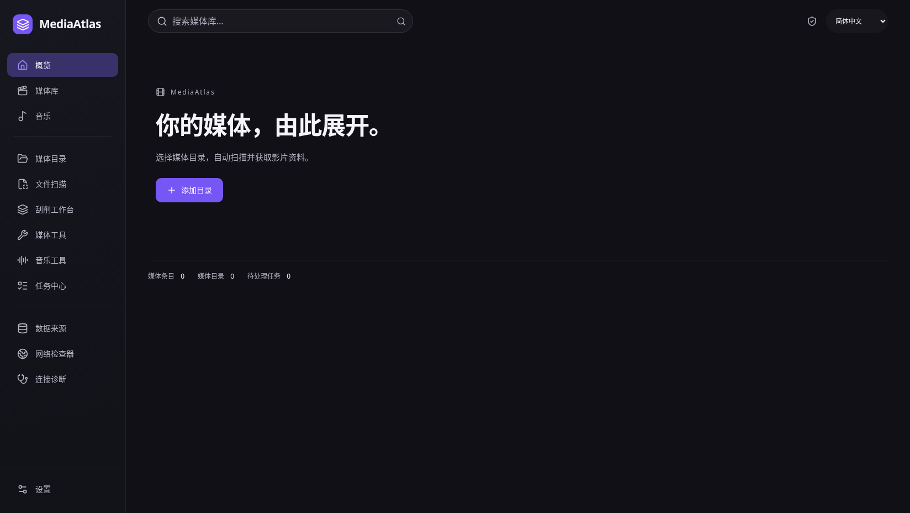

**我的下一步 / 注意点：** 点击首页“添加目录”，进入媒体目录页后，目前还要再点一次“添加目录”。

## 02 · 我选文件夹，再选资源类型

**日常主线**。点“选择文件夹”，目录名称自动填好；确认电影、剧集或其他类型，然后点“添加到媒体库”。

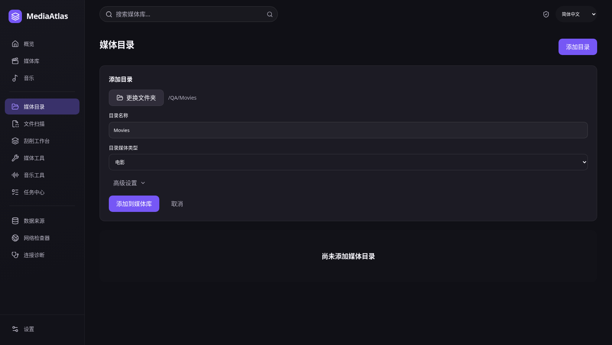

**我的下一步 / 注意点：** 日常不需要手填路径；高级设置是备用入口。图中显示的是选择完成后的界面，未展示系统文件夹窗口。

## 03 · 文件先出现，资料在后台慢慢补

**日常主线**。保存后直接来到媒体库。即使海报还没有，条目也已经能看到；上方会显示正在补全媒体资料。

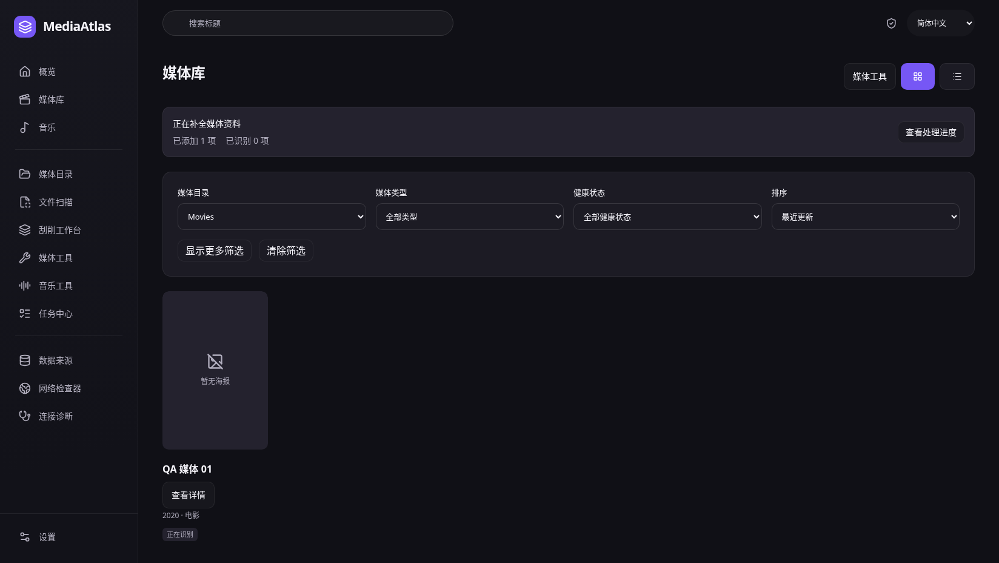

**我的下一步 / 注意点：** 我可以继续浏览，不需要逐个确认入库。自动补全资料的前提是对应来源已启用，并已保存所需凭据。

## 04 · 想知道处理到哪儿，我才看进度

**可选查看**。点击“查看处理进度”，可以看到扫描、索引与资料匹配的状态，以及已添加、待处理等数量。

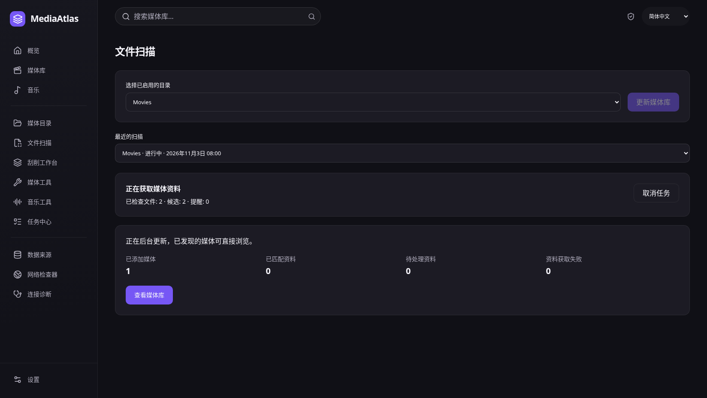

**我的下一步 / 注意点：** 这是查看进展的支路，不是每次添加目录后必须经过的确认页。离开这个页面不会停止后台任务。

## 05 · 以后我直接从媒体库找片

**日常主线**。可靠匹配完成后，媒体库显示封面与资料。我按名称搜索，或按目录、类型筛选，再点“查看详情”。

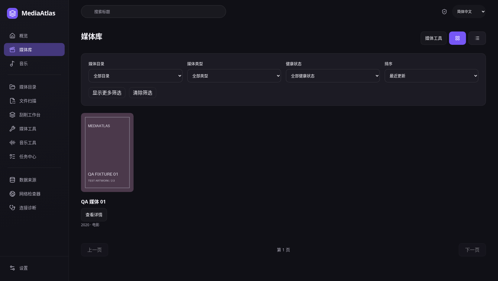

**我的下一步 / 注意点：** 图中只有一部明确标注的演示媒体。它不是在线来源返回的真实影片，也没有虚构观看进度。

## 06 · 看一眼详情，再交给系统应用打开

**日常主线**。我在详情确认自己选对了内容，然后点击“使用系统应用打开”。这里不需要再走一次刮削。

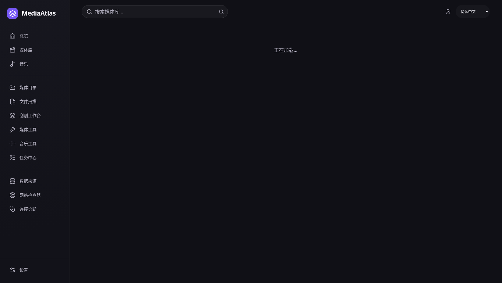

**我的下一步 / 注意点：** MediaAtlas 管理和浏览媒体；实际播放由系统关联应用负责，不在这里嵌入播放器。

## 07 · 同一条目有多个文件，我选一个打开

**有多个版本时**。单个可打开文件会直接提交打开请求；多个版本或 Part 才显示选择框，避免应用替我猜。

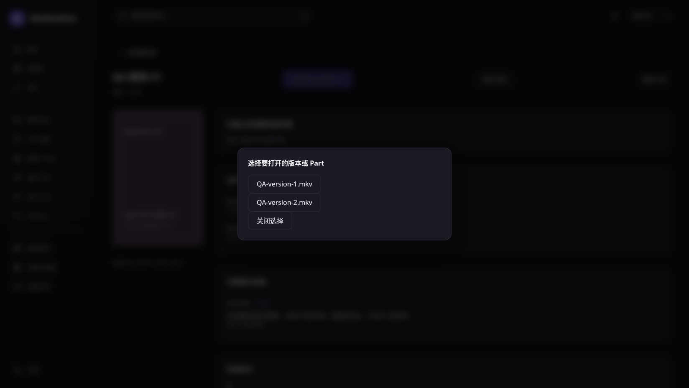

**我的下一步 / 注意点：** 当前选择成功后弹窗仍保留，我需要手动关闭。此次只验证界面提交了打开请求，未启动真实系统播放器。

## 08 · 遇到“需要配置凭据”，我去补一次配置

**例外：缺少凭据**。没有来源凭据时，检索按钮不可用。点击“配置凭据”进入设置，原来的媒体上下文会保留。

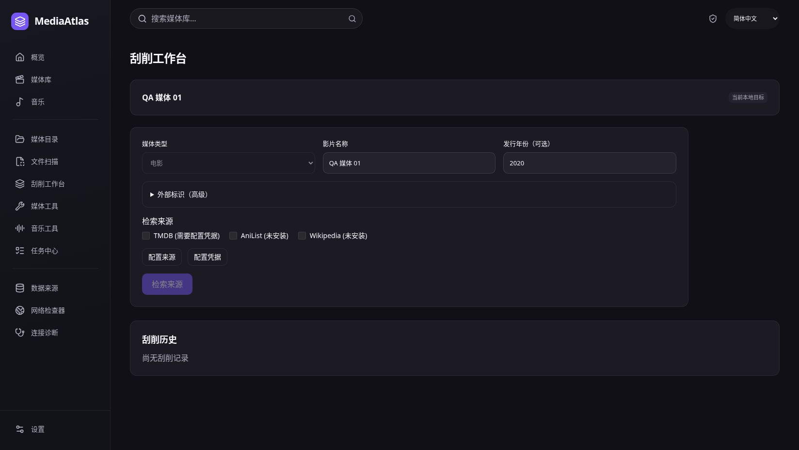

**我的下一步 / 注意点：** 本地文件依然可以浏览；缺少在线资料不等于添加失败。来源未启用时，还需要完成后面的启用步骤。

## 09 · 我把自己的 Token 保存到设置

**首次配置**。选择认证来源和方式，手动填写自己的 Token，再点“保存认证”。截图中凭据为空，不包含任何密钥。

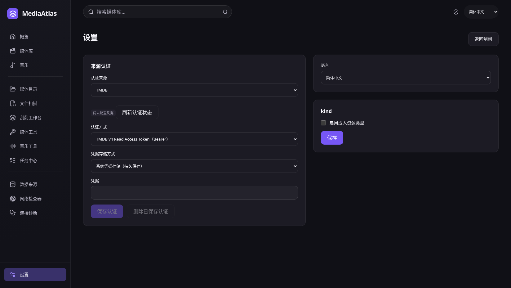

**我的下一步 / 注意点：** 保存认证不会自动启用来源。右侧当前还出现了未翻译的“kind”，这是实际界面问题，不是文档中的命名。

## 10 · 还要到“数据来源”确认它已启用

**首次配置**。在数据来源页确认对应来源的“启用”开关。这里展示已启用状态；保存认证和启用来源是两个动作。

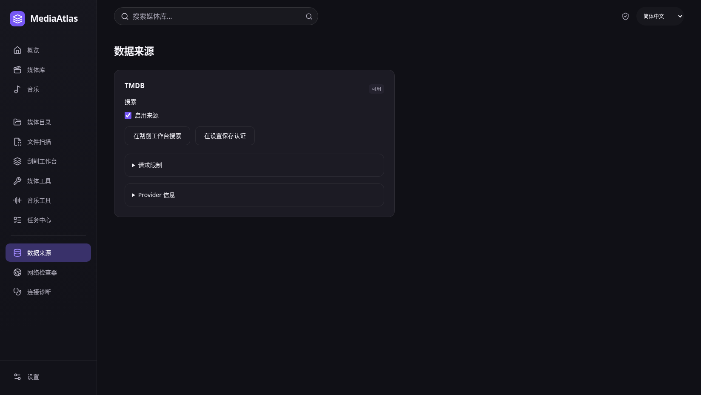

**我的下一步 / 注意点：** 完成配置后，回到对应目录或扫描页重新更新资料；不需要重新添加目录。配置流程目前分散，这是新用户容易卡住的地方。

## 11 · 只有识别不对时，我才手动更正

**例外：匹配不对**。从媒体工具进入当前条目的刮削页面：检索来源 → 选择候选 → 预览合并 → 确认所选元数据。

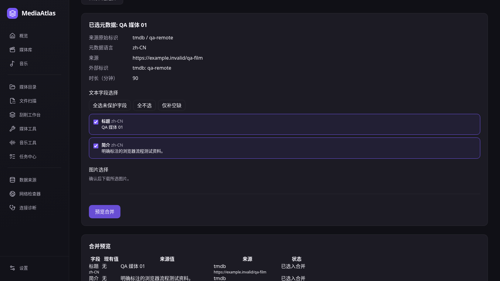

**我的下一步 / 注意点：** 这是纠错支路，不是每部影片的必经步骤。写 NFO 或海报旁车另有预览与确认，和更新应用内资料分开。

## 12 · 成人资源也只是在这里选一种类型

**可选资源类型**。在设置启用成人资源类型后，我在同一个媒体库选择“成人视频”，浏览和详情沿用共享界面。

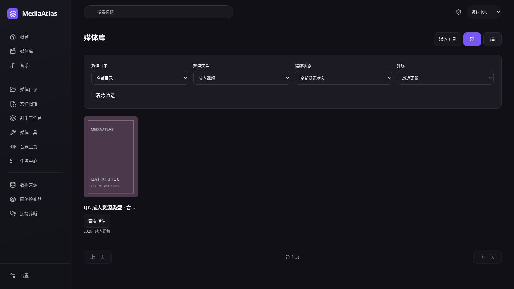

**我的下一步 / 注意点：** 没有额外成人中心或解锁步骤。普通“全部”列表和首页仍不混入该类型，关闭设置后不再显示相关内容。

## 作为用户，我认为还需要改善的地方

- **首次添加有重复点击：** 首页“添加目录”只带我去目录页，还要再点一次才能打开表单。更顺的体验是直接进入选择文件夹。
- **首次来源配置不够连贯：** 凭据保存在设置，启用开关在数据来源，配置完还要回去更新。需要把这几个动作串成一个可完成的引导。
- **打开后的反馈没有收尾：** 多版本文件提交打开请求后，选择框还留在原地，容易让我怀疑是否成功并再次点击。
- **入口仍然偏多：** 文件扫描、刮削工作台、媒体工具、任务中心同时出现；作为只想添加目录和找片的用户，我仍要判断应该去哪。
- **设置有未翻译文字：** 中文设置页出现“kind”。这属于当前缺陷，需要修复，但这次截图文档没有修改产品界面。

当前主线已经去掉手动入库，但“第一次配置”和“打开后的反馈”仍需打磨。以上是走查发现，不代表这些后续改进已经完成。

本次没有修改应用代码，也没有移动 tag。截图对应 main，不对应较早的 beta.3。系统选择文件夹和默认应用打开使用测试适配器验证，不能作为原生端到端验收。
