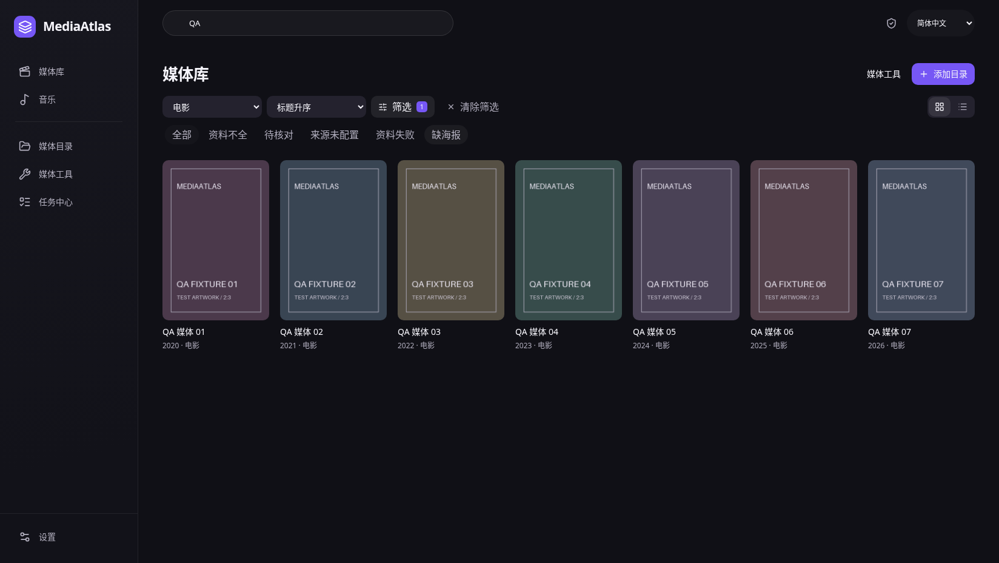
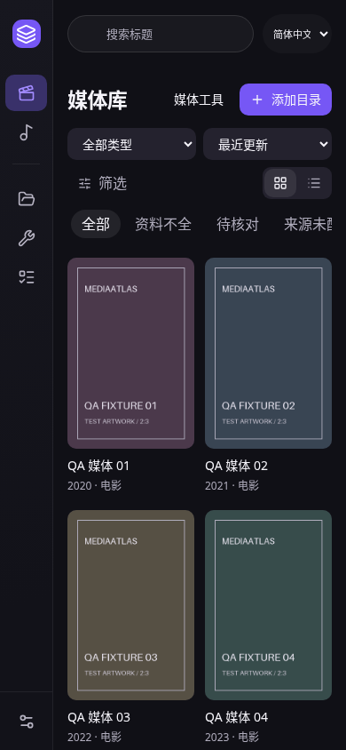
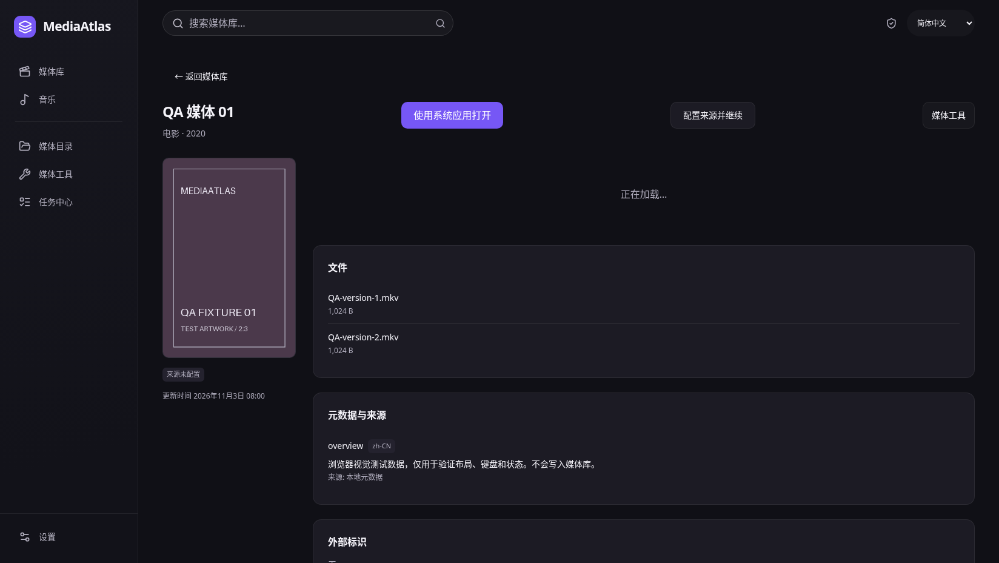
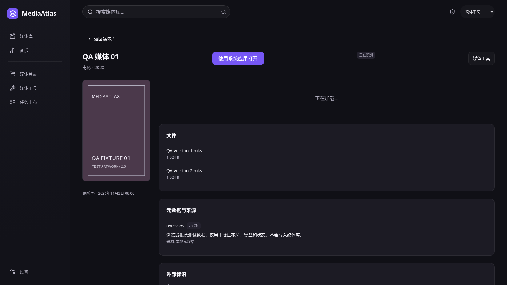
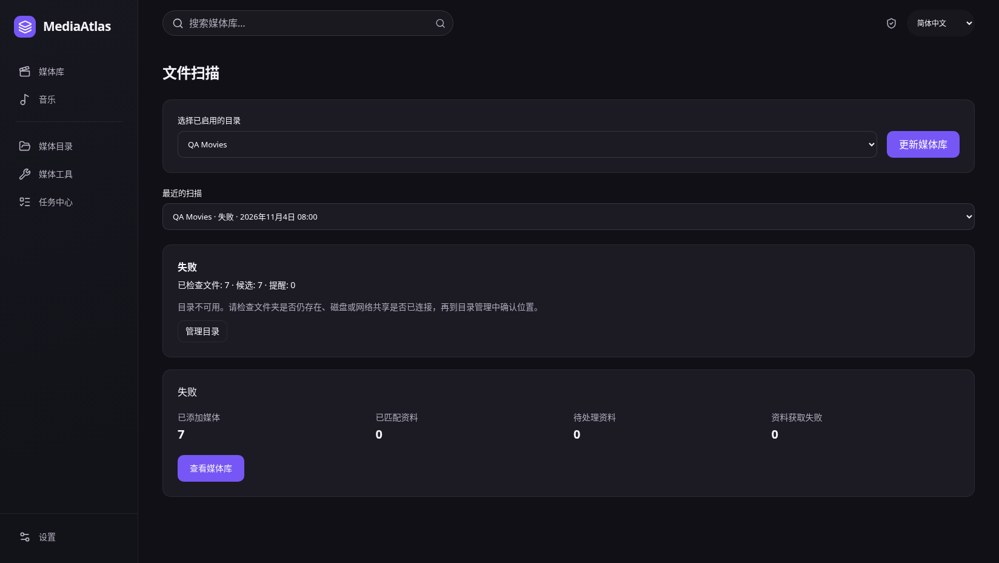
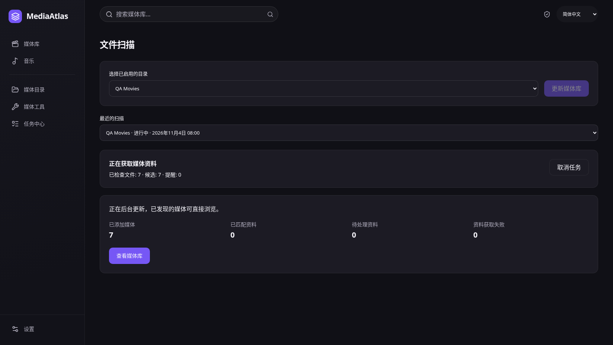

# 社区流程改进验收（2026-11-04）

研究依据与取舍见 [Emby 与成熟刮削工具流程改进](../../docs/emby-scraper-workflow.md)。功能源码 `3c6ba99`，本轮前端 43 文件 / 346 测试，lint、typecheck、生产构建全部通过。此前主流程完整浏览器回归通过，本轮另验证快捷筛选、详情配置、真实目录范围、处理中与扫描失败/取消恢复。

以下六张为实际 Chromium 页面截图，1648×928 / 390×844，使用合成 IPC、明确标记的测试海报与任务数据；没有拼接或修补截图。浏览器 fixture 不替代真实 OS 选择器、keyring、实时 Provider 或原生宿主验收。本轮没有 Rust 或依赖变更，不等待桌面打包、不移动 tag。详细哈希见 [report.json](report.json)。

## 快捷处理与窄屏

“全部”只清健康过滤，保留目录、类型、检索和排序；筛选调用服务端查询并重置失效分页，不显示无依据数量。截图展示清除健康筛选后的演示媒体墙。

## 从当前媒体恢复

缺来源时直接携带唯一实际目录进入配置，进入设置本身不启用来源、不保存凭据、不触发更新。处理中显示真实状态。

## 失败与停止

目录不可用给出检查和管理入口；停止后明确已收录内容保留，并可通过实际后台更新继续。第二张为点击重新更新后的运行状态，不代表已完成刮削。

复现：启动当前前端后运行 `MEDIAATLAS_QA_URL=http://127.0.0.1:1432 python scripts/desktop-community-flow-qa.py`；完整旧主流程回归通过 `scripts/desktop-library-wall-qa.py`，输出设置到独立临时目录以免覆盖历史证据。
