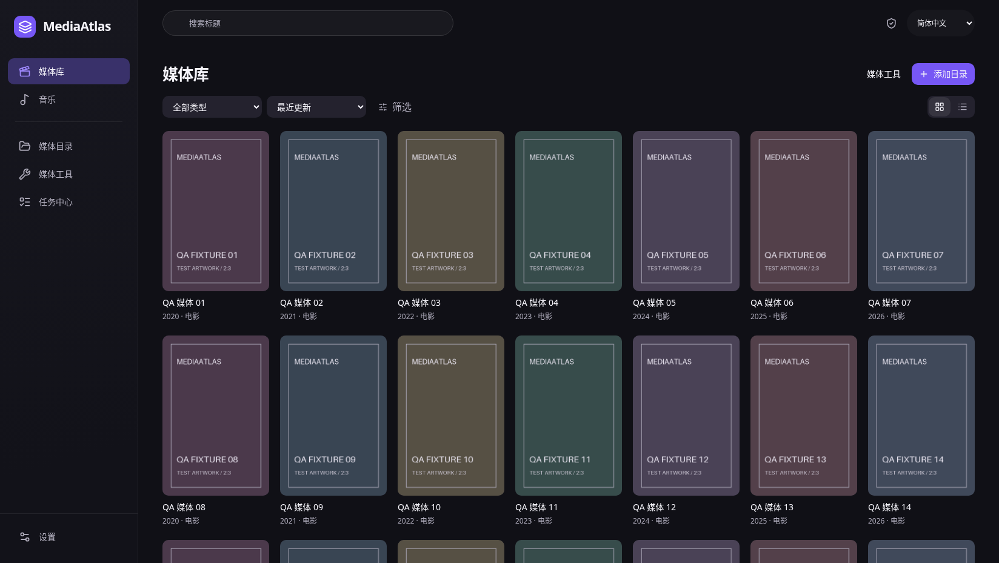
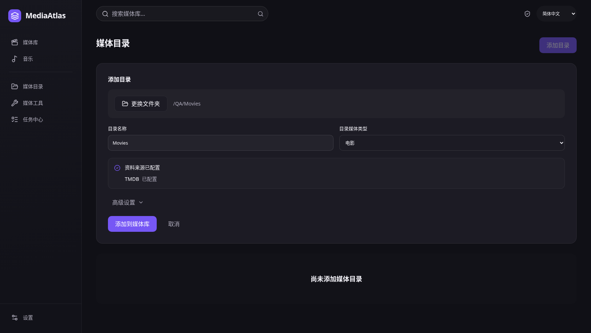
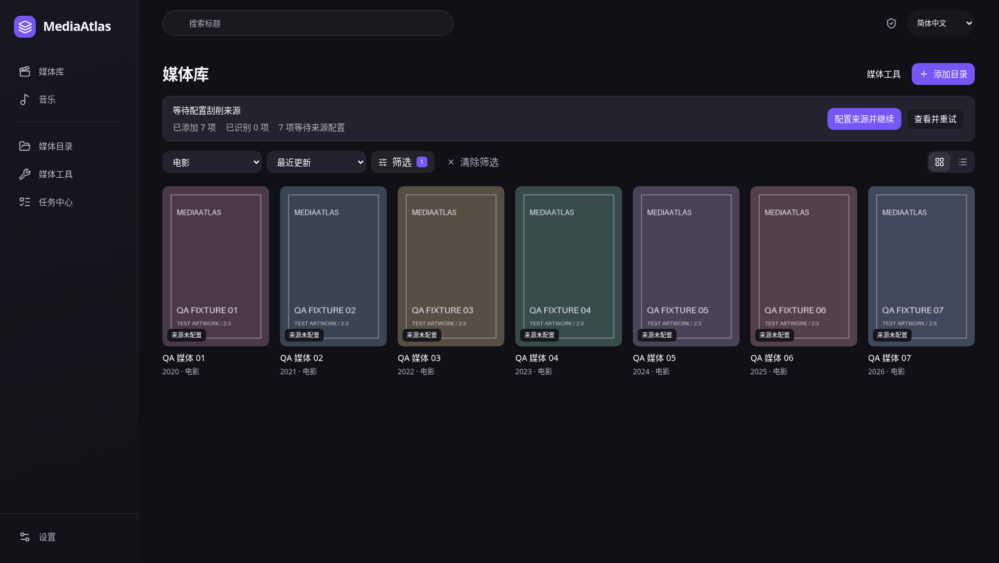
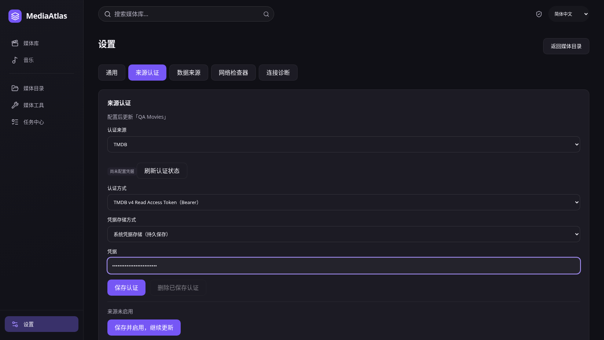
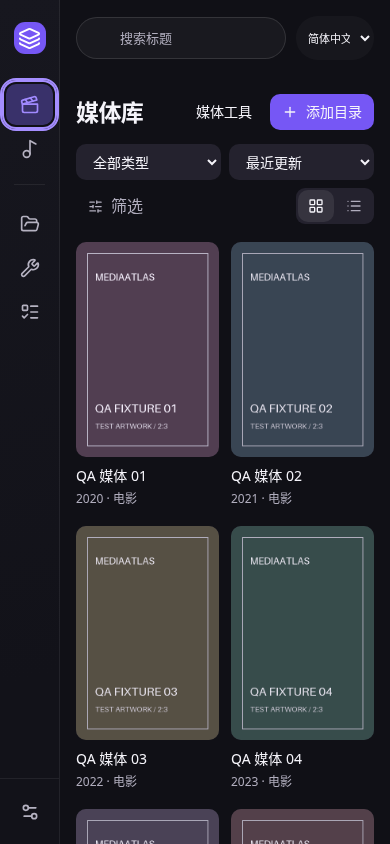

# 媒体墙与设置整合验收（2026-11-04）

源码提交 `52679c2`，删除概览，默认进入媒体库。日常侧栏六个入口：媒体库、音乐、媒体目录、媒体工具、任务中心、设置。扫描从目录/工具进入，三个管理页面归设置标签，不再保留其旧路由。

添加目录直接选择文件夹，再确认名称与类型。来源未配置时可以先收录本地文件，但明确显示资料未获取；配置流程由用户明确执行保存、启用和更新，不会把单纯保存配置标记为刮削完成。历史无任务记录的缺来源条目也提供配置入口。

前端 `pnpm check` 全通过：41 文件 / 303 测试、lint、typecheck、生产 build。Rust 329 项测试、Clippy 零警告、Rust 格式与许可证清单检查通过。本轮浏览器 26 张实际截图、9 组情景、0 页面错误，包含键盘、减少动态、1648×928 / 390×844 以及加载/空/错误/缺图。详情与哈希见 [report.json](report.json)。

截图使用明确标记的测试海报和合成 IPC；没有修改、拼接或生成截图，不代表真实系统目录窗口、keyring、播放器、在线 Provider 或完整 Tauri 宿主已通过。未等待桌面打包，既有 tag 未移动。

## 默认海报墙

## 目录管理

## 来源缺失与继续配置

## 设置标签

## 窄屏

复现：启动当前前端，运行 `MEDIAATLAS_QA_URL=http://127.0.0.1:1432 python scripts/desktop-library-wall-qa.py`。可用 `--settings-only` 只复核设置标签；当前截图来源为 Vite 前端，完整生产构建另由 `pnpm check` 验证。
