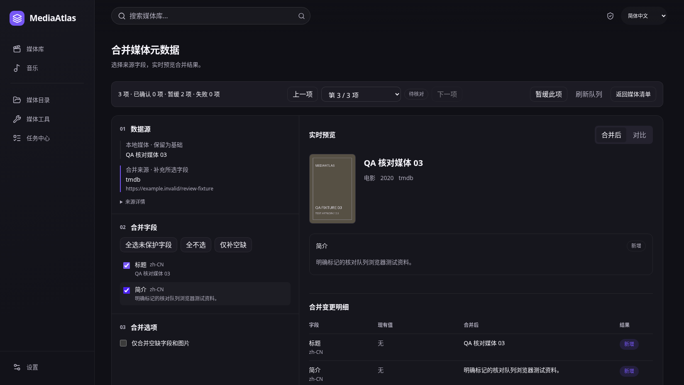

# 实时合并与固定导航验收

2026-11-04 使用系统 Chromium 运行实际桌面前端，16 组场景通过，保存 15 张原始浏览器截图。参考视口 1648×928，窄屏 390×844，短窗口 390×360；全部开启 `prefers-reduced-motion: reduce`。截图未编辑。

本次实现 `3775525d6cdadab47f2ceb16635dcb5effc8cc69`：字段选择即时更新右侧合并效果与变更明细，自动校验后再显式确认；状态使用非交互 Badge。左侧导航和底部设置固定，只有右侧内容滚动，短窗口的导航项可在侧栏内部滚动。



[右侧滚动后：变更明细与确认栏](fixture-fixed-navigation-scroll-1648.png) · [前后对比](fixture-merge-compare-1648.png) · [窄屏合并](fixture-live-merge-narrow-390.png)

```sh
MEDIAATLAS_QA_URL=http://127.0.0.1:1432 python scripts/desktop-review-queue-qa.py
```

使用明确标为 `QA 核对媒体` 的合成 IPC 数据，账本保存在测试 localStorage 中，跨实际 reload 恢复。它验证前端交互和命令顺序，不代表真实 Rust 数据库持久化、应用进程重启、第三方匹配、系统凭据或文件写入已经通过。占位海报属于明确标记的 QA fixture。

| 场景 | 结果与证据 |
| --- | --- |
| 实时预览与对比 | 选择候选直接进入双栏；取消勾选立即更新画面、计数和明细；无额外“预览合并”按钮；方向键切换共享 Tabs；[工作区](fixture-live-merge-1648.png)、[对比](fixture-merge-compare-1648.png) |
| 仅补空缺与零变更 | 保留已有 canonical 标题；无变更时禁止确认；[仅补空缺](fixture-merge-missing-only-1648.png) |
| 校验失败与重试 | 对应后端预览失败时禁止确认，显式重试成功才能继续；[失败状态](fixture-merge-validation-error-1648.png) |
| 固定侧栏与右侧滚动 | wheel 只移动右侧，文档 scrollY 保持 0，侧栏与底部设置坐标不变；键盘聚焦不会被工具栏遮住；[滚动后](fixture-fixed-navigation-scroll-1648.png) |
| 短窗口侧栏 | 390×360 导航项内部滚动，底部设置保持可见；[短窗口](fixture-fixed-navigation-short-390.png) |
| 创建与暂缓恢复 | 选中 3 项创建 session，暂缓后实际 reload 还原状态和第二项，无自动确认；[创建后](fixture-created-session-1648.png)、[恢复后](fixture-restored-session-1648.png) |
| 配置凭据往返 | 手动保存合成凭据，返回同一 session 与媒体；[返回后](fixture-settings-return-1648.png) |
| 失败恢复 | 检索失败写入测试账本；reload 不自动重试；显式重新核对也不自动搜索；[失败恢复](fixture-persisted-failure-1648.png)、[显式重试](fixture-explicit-failure-retry-1648.png) |
| 显式确认顺序 | 断言 `scraper_preview → review_queue_checkpoint → scraper_confirm → review_queue_update(action=confirmed)`，无 `scraper_output_execute`；[确认后](fixture-confirmed-proof-order-1648.png) |
| 返回与失效资源 | 返回保留 root、q、kind、health、sort；过期 checkpoint 不重放确认；目录停用或媒体删除阻止工作区继续；[目录停用](fixture-disabled-root-1648.png) |
| 32 项边界与状态 | 跨页超限整体拒绝，无静默截断；32 项仅一枚当前状态 Badge，不生成 32 个状态按钮 |
| 窄屏、键盘、缺图 | 390×844 无横向溢出；Enter 暂缓不确认；实时合并纵向布局，缺海报回退；[队列](fixture-keyboard-narrow-390.png)、[合并](fixture-live-merge-narrow-390.png) |

`pnpm check` 通过：50 文件 / 428 测试、lint、typecheck、生产 build；确认、输出写入和取消另通过三个 DOM 提交瞬间点击回归，正确绑定当前预览 ID，显式取消和清理仅释放一次。发布工具和原生签名验证独立记录在 [macOS 安装包修复](../../docs/hotfix-macos-package.md)与 [Windows CI 修复](../../docs/hotfix-windows-ci.md)；本组浏览器证据不替代原生包验证。单元测试另覆盖仅补空缺期间其他任务填入字段、服务器 proof 与画面不一致时禁止确认，刷新后使用新的有效 proof。

[report.json](report.json) 记录实际执行基线、工作区摘要、受测源码与截图 SHA-256；受测源码指纹逐项与上述实现提交核对一致。设置返回与重载恢复画面相同，是恢复到同一媒体位置的预期结果。

本次未重跑本地 Rust 或原生安装包；原队列实现 `c81e6ec` 的 Rust 343 项、Clippy、格式检查为独立历史记录，beta.6 的实际 Tauri 产物以其发布流水线为准。
